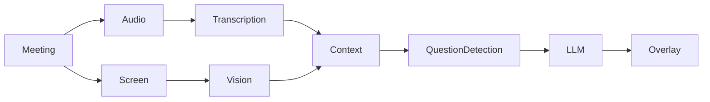

# OpenMeet

**Real-time open-source AI meeting overlay.**

OpenMeet sits quietly on top of Zoom, Google Meet, Microsoft Teams, Slack
huddles, Discord or any browser meeting. It transcribes the conversation,
detects questions and turns, understands what was said before (and, if you
allow it, what is on your screen), and streams a useful suggestion into a small
always-on-top HUD — so you never have to leave the meeting window.

* **Candidate mode** — for the person answering: suggested answers with key
  points, examples, clarifying questions, and questions you could ask back —
  grounded in *your* notes, never invented history.
* **Interviewer mode** — for the person asking: grounded follow-up questions
  based on what the candidate actually said, with the reason for each, topic
  coverage, duplicate avoidance and a post-interview summary. No scores, no
  hiring recommendations — the human decides.

OpenMeet is a copilot, not an autonomous participant: it never speaks into the
meeting. It is **local-first** (local transcription, local LLMs, local OCR and
embeddings are first-class), has **no telemetry**, and makes capture visible and
controllable at all times.

> ⚠️ Use responsibly. Recording, transcribing or using AI assistance in a
> conversation may require other participants' consent and may be restricted by
> law, your employer, the meeting platform or the rules of an interview or exam.
> See [PRIVACY.md](PRIVACY.md#9-responsible-use-and-consent).

---

## Features

**Live overlay (the primary UI)**
* Transparent, frameless, always-on-top HUD that does not steal focus from the
  meeting app; draggable, resizable by content, per-display and per-app
  remembered positions, multi-monitor aware (DPI / scaling / orientation).
* States: listening, thinking, question detected, streaming answer, follow-ups,
  minimal HUD, paused, **PROCESSING STOPPED**.
* Click-through mode, adjustable opacity / width / font size / density,
  dark & light themes, translucent and minimal modes, reduced motion.
* Answer controls: regenerate, shorter, longer, more technical, simplify, give
  example, show reasoning (a short rationale — never hidden chain-of-thought),
  copy, pin, dismiss. Seven answer styles including STAR and step-by-step.
* **Ask OpenMeet** anytime (`Ctrl/Cmd+Shift+A`) with the current meeting and
  screen context — works even without transcription.

**Understanding the meeting**
* Streaming transcription with voice activity detection; speaker attribution
  (you vs. other participants) from microphone vs. system audio.
* Question detection that handles missing punctuation, indirect prompts
  ("walk me through…"), multi-part and continued questions, and filters false
  positives ("the question I was thinking about was…"); 13 categories.
* Context engine: recent transcript, rolling compressed summary, hybrid
  retrieval (BM25 + embeddings) over earlier discussion, claims, topics,
  previous questions and answers, and screen observations.
* Screen + audio fusion: "Can you explain *this* part of the architecture?"
  resolves to the diagram on screen.
* Interviewer tools: claim extraction, gap detection, topic tracking with a
  suggested next area, semantic duplicate detection for follow-ups.
* Optional voice commands ("OpenMeet, give me a follow-up").

**Privacy & control**
* Nothing is captured until you start a meeting; screen context is off unless
  you enable it for a source you choose; privacy rules exclude apps, windows,
  domains and regions.
* One-key **emergency stop**, pause, local-only mode, per-component
  local/cloud data-flow view, retention policies (default 7 days, or never
  written to disk), one-click delete of all meeting data.
* API keys in the OS credential store; no telemetry; sanitized logs.
* Optional capture exclusion of OpenMeet's windows using documented OS APIs
  (see [limitations](#capture-exclusion)).

**After the meeting**
* Summary (overview, key topics, questions, answers, decisions, action items,
  open questions, technical topics, follow-up suggestions; interviewer
  coverage, areas needing clarification, claims to verify, unexplored topics).
* History with transcript, Q&A, suggestions, follow-ups, topics, claims and
  screen observations; export to Markdown, JSON or plain text.

**Everything else**
* Tray app, configurable global shortcuts with conflict detection, demo mode,
  developer simulation tools, diagnostics with per-stage latency and a
  benchmark.

## Architecture



A Rust core (Tauri 2) runs the real-time pipeline — audio capture, VAD,
transcription, question detection, context assembly, request orchestration with
cancellation and stale-response protection, streaming, storage — and emits
typed events to two React windows: the overlay and the secondary main window.
See [docs/ARCHITECTURE.md](docs/ARCHITECTURE.md).

| Layer | Technology |
|-------|-----------|
| Desktop shell | Tauri 2, Rust (tokio) |
| UI | React 19, TypeScript, Vite, Tailwind CSS 4, Zustand |
| Storage | SQLite (rusqlite), OS credential store for keys |
| Audio / screen | cpal, xcap, Windows.Media.Ocr |
| Local AI | Ollama (LLM), faster-whisper + fastembed sidecar in a Python venv |
| Cloud AI (optional) | OpenAI, Anthropic, any OpenAI-compatible endpoint |

## Supported platforms

| | Windows 10/11 | macOS 12+ | Linux |
|---|---|---|---|
| Overlay, hotkeys, tray | ✅ | ✅ | ✅ (depends on window manager for always-on-top / focus behaviour) |
| Microphone | ✅ | ✅ | ✅ |
| System / meeting audio | ✅ WASAPI loopback | ⚠️ where the OS allows; otherwise via a virtual device such as BlackHole | ✅ PulseAudio / PipeWire monitor sources |
| Screen context | ✅ | ✅ (Screen Recording permission) | ✅ X11; Wayland via portal where supported |
| Local OCR | ✅ Windows.Media.Ocr | ➖ use a vision model | ➖ use a vision model |
| Capture exclusion | ✅ Windows 10 2004+ | ⚠️ best effort | ❌ not supported |

Windows is the primary development and test platform.

## Installation

Pre-built installers are published on the Releases page (Windows NSIS/MSI,
macOS DMG, Linux deb/AppImage). On first launch, OpenMeet walks you through
mode, AI provider, transcription, microphone, optional screen context and
privacy settings.

For fully local operation:

1. Install [Ollama](https://ollama.com) and pull a model: `ollama pull llama3.2`.
2. Install the local AI sidecar (Python 3.10–3.12):
   `powershell -ExecutionPolicy Bypass -File scripts\setup-local-ai.ps1 -DownloadModels`
   (Windows) or `scripts/setup-local-ai.sh --download-models` (macOS/Linux).
3. In OpenMeet: Settings → Privacy → **Local-only mode**.

## Development

```bash
npm install
npm run tauri dev
```

Prerequisites, tests, developer tools and packaging:
[docs/DEVELOPMENT.md](docs/DEVELOPMENT.md). Crate contracts:
[docs/INTERNALS.md](docs/INTERNALS.md); frontend contract:
[docs/FRONTEND.md](docs/FRONTEND.md).

## AI providers

| Component | Local | Cloud |
|-----------|-------|-------|
| LLM | Ollama, OpenAI-compatible servers (LM Studio, llama.cpp, vLLM) | OpenAI, Anthropic, OpenAI-compatible |
| Transcription | Local AI sidecar (faster-whisper) | OpenAI, OpenAI-compatible |
| Screen | Windows OCR, Ollama vision models | OpenAI / Anthropic vision |
| Embeddings | Built-in hashing, Local AI (fastembed), Ollama | OpenAI |

Mix and match freely. Details, defaults and model rules:
[docs/PROVIDERS.md](docs/PROVIDERS.md).

## Local mode

With the local providers above, OpenMeet runs entirely on your machine:
transcription, LLM, OCR, embeddings and storage. Enable **local-only mode** to
make OpenMeet refuse any provider whose endpoint is not on this device. The
Privacy page shows each component as *Local* or *Cloud* and states **"No meeting
data leaves this device."** only when that is actually true for the active
configuration. When a cloud provider is configured, the UI labels it as
**Cloud AI** and lists exactly which components are remote.

## Privacy

* No telemetry, no analytics, no background network traffic.
* Capture only during meetings you start; screen context opt-in per meeting.
* Audio is never written to disk; screenshots only if you explicitly enable it.
* Retention: do not retain / 1 / 7 (default) / 30 days / until deleted;
  one-click delete-all.

Read [PRIVACY.md](PRIVACY.md) for exactly what is processed, sent and stored.

### Capture exclusion

OpenMeet can ask the OS to exclude its windows from screen capture using
**documented** platform capabilities — `SetWindowDisplayAffinity(WDA_EXCLUDEFROMCAPTURE)`
on Windows 10 2004+ and `NSWindow.sharingType = .none` on macOS. Support varies
by platform and by capture technology: it only affects capture tools that honour
the OS flag, is not available on Linux, and does not hide anything from cameras,
hardware capture or software that bypasses those OS paths. OpenMeet does not use
undocumented capture tricks or anything that defeats security, proctoring, DRM
or anti-cheat software. The settings show whether exclusion is supported and
active on your system.

## Security

Least-privilege, per-window IPC capabilities, strict CSP, typed and validated
commands, keys in the OS credential store, prompt-injection hardening, sanitized
logs, dependency auditing in CI. Report vulnerabilities privately — see
[SECURITY.md](SECURITY.md).

## Roadmap

**Phase 1** — Desktop overlay · audio · transcription · candidate mode ·
interviewer mode *(this release)*

**Phase 2** — Screen context · local models · better retrieval *(screen
context, OCR, local Whisper/LLM/embeddings and hybrid retrieval ship today;
next: on-device vision models out of the box, cross-meeting retrieval)*

**Phase 3** — Multi-monitor polish · advanced interviewer workflows (question
banks, structured interview plans, rubric-free note templates) · meeting
knowledge base

**Phase 4** — Plugin ecosystem (transcription, LLM, vision, knowledge-source
and export providers built on the existing provider traits) · provider
marketplace · advanced local inference (streaming on-device ASR, diarization)

## Contributing

Contributions are welcome — please read [CONTRIBUTING.md](CONTRIBUTING.md) and
the [Code of Conduct](CODE_OF_CONDUCT.md). Use demo mode for screenshots and bug
reports; never share real meeting content.

## License

[Apache License 2.0](LICENSE). Copyright © 2026 OpenMeet contributors.
