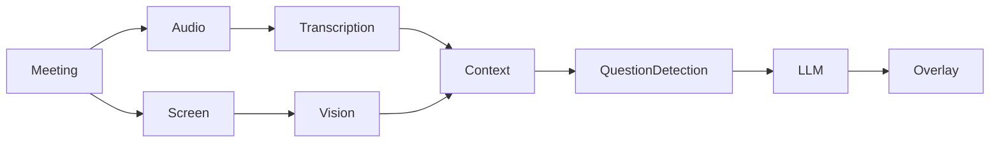

# OpenMeet

**Real-time open-source AI meeting overlay.**

OpenMeet sits quietly on top of Zoom, Google Meet, Microsoft Teams, Slack
huddles, Discord or any browser meeting. It transcribes the conversation,
detects questions and turns, understands what was said before (and, if you
allow it, what is on your screen), and streams a useful suggestion into a small
always-on-top HUD — so you never have to leave the meeting window.

* **Candidate mode** — for the person answering: suggested answers with key
  points, examples, clarifying questions, and questions you could ask back —
  grounded in *your* notes, never invented history.
* **Interviewer mode** — for the person asking: grounded follow-up questions
  based on what the candidate actually said, with the reason for each, topic
  coverage, duplicate avoidance and a post-interview summary. No scores, no
  hiring recommendations — the human decides.
* **Workplace mode** — for ordinary team meetings (stand-ups, reviews,
  planning, 1:1s): a live board of decisions, action items with owner and due
  date, and open questions; answers to questions put to you; a "Catch me up"
  summary; and minutes with a follow-up message when the meeting ends. Nobody
  is interviewed or scored. See [docs/WORKPLACE.md](docs/WORKPLACE.md).

OpenMeet is a copilot, not an autonomous participant: it never speaks into the
meeting. It is **local-first** (local transcription, local LLMs, local OCR and
embeddings are first-class), has **no telemetry**, and makes capture visible and
controllable at all times.

> ⚠️ Use responsibly. Recording, transcribing or using AI assistance in a
> conversation may require other participants' consent and may be restricted by
> law, your employer, the meeting platform or the rules of an interview or exam.
> See [PRIVACY.md](PRIVACY.md#9-responsible-use-and-consent).

---

## Trained models at a glance

Besides ready-made models (Whisper for speech-to-text, MediaPipe for face and
iris points, and Llama 3.2 or Gemini for follow-up questions), this project
trains three models of its own. They power the **answer-integrity check**,
which helps an interviewer notice when a candidate may be reading an answer or
giving one written by an AI tool. A score is a reason to ask a follow-up
question, never a verdict.

| Model | The question it answers | Trained on | Method | Result on unseen data |
|---|---|---|---|---|
| **Reading detector** (the shipped network) | From 10 s of eye movements, is the person reading? | GazeBase (322 people), degraded to webcam quality | Small 1-D CNN on the gaze trace (10 samples per second), three seeds averaged | **98.8%** balanced accuracy on 64 unseen GazeBase people with webcam-quality noise. Not yet scored on real-world reading with this network |
| **Reading detector, real-world model** (not shipped) | Same question, for everyday reading | Reading in the Wild (81 people wearing eye-tracking glasses) | The same kind of CNN, trained and tested on its own people | **83.0%** balanced accuracy per 10 s window with eye-tracker input; 79.1% with webcam-style noise |
| **Gaze model** (not yet in the app) | Where are the eyes looking, from a webcam face image? | MPIIFaceGaze (37,667 webcam images, 15 people) | ResNet-18 transfer learning from a gaze-trained network | **4.54°** average error, against 7.18° for the MediaPipe method used today |
| **AI-written answer detector** (v2, shipped) | Does this answer's transcript read like AI-written text? | HC3 (human vs ChatGPT answers) plus 54 interview-style question and answer pairs | TF-IDF word features with logistic regression | **98.0%** balanced accuracy on unseen HC3 questions (AUC 0.998); at its `high` level it catches 97.8% of AI answers and flags 1.8% of human ones |

Two more integrity signals are not trained models. **Echo similarity** compares
an answer with two answers that Llama 3.2 writes to the same question
(embeddings and cosine similarity); its thresholds were measured on HC3 public
data (ROC-AUC 0.876) and are marked calibrated for that data. **Delivery**
compares the timing of an answer with the candidate's first three answers; its
weights and thresholds are set by hand and it is **uncalibrated**. The early
reading detector, which scores 3 to 10 seconds of gaze, is hand-tuned and
uncalibrated as well. It counts at most as *possible*. No signal has been
calibrated on real interviews yet.

**New to machine learning?** Read the beginner's guide,
[docs/MODELS.md](docs/MODELS.md). It explains what each model does, the data
and features behind it, how it was trained and tested, the results and their
limits, with a glossary of the terms used. All measured numbers, with how they
were measured, are in [docs/BENCHMARKS.md](docs/BENCHMARKS.md).

Where the code is: the training code is in `training/gaze-detection` and
`training/echo-detection`. The models run inside the local AI sidecar
(`local-ai/integrity`), and the browser interview room is in `local-ai/room`.
The shared definitions, thresholds and test fixtures of the integrity check are
in [`spec/integrity/`](spec/integrity/README.md).

---

## Features

**Live overlay (the primary UI)**
* Transparent, frameless, always-on-top HUD that does not steal focus from the
  meeting app; draggable, resizable by content, per-display and per-app
  remembered positions, multi-monitor aware (DPI / scaling / orientation).
* States: listening, thinking, question detected, streaming answer, follow-ups,
  minimal HUD, paused, **PROCESSING STOPPED**.
* Click-through mode, adjustable opacity / width / font size / density,
  dark & light themes, translucent and minimal modes, reduced motion.
* Answer controls: regenerate, shorter, longer, more technical, simplify, give
  example, show reasoning (a short rationale — never hidden chain-of-thought),
  copy, pin, dismiss. Seven answer styles including STAR and step-by-step.
* **Ask OpenMeet** anytime (`Ctrl/Cmd+Shift+A`) with the current meeting and
  screen context — works even without transcription.

**Understanding the meeting**
* Streaming transcription with voice activity detection; speaker attribution
  (you vs. other participants) from microphone vs. system audio.
* Question detection that handles missing punctuation, indirect prompts
  ("walk me through…"), multi-part and continued questions, and filters false
  positives ("the question I was thinking about was…"); 13 categories.
* Context engine: recent transcript, rolling compressed summary, hybrid
  retrieval (BM25 + embeddings) over earlier discussion, claims, topics,
  previous questions and answers, and screen observations.
* Screen + audio fusion: "Can you explain *this* part of the architecture?"
  resolves to the diagram on screen.
* Interviewer tools: claim extraction, gap detection, topic tracking with a
  suggested next area, semantic duplicate detection for follow-ups.
* Optional voice commands ("OpenMeet, give me a follow-up").

**Interviews and team meetings**
* **Answer-integrity check** (interviewer mode, off by default): after each
  candidate answer, four signals (AI-written text, similarity to an LLM's
  answer, delivery timing, eye movements that look like reading) are combined
  into one flag, shown privately with its evidence. It is a reason to ask a
  follow-up question, never a verdict. See
  [docs/INTEGRITY.md](docs/INTEGRITY.md).
* **OpenMeet Room**: a one-to-one interview room in the browser, hosted from the
  interviewer's own computer (`local-ai/room`). The candidate only opens a link.
  Transcription, the integrity signals and follow-up questions run on the
  interviewer's computer by default. Access from other networks uses an
  optional Cloudflare tunnel, which is off unless it is started. See
  [local-ai/room/README.md](local-ai/room/README.md).
* **Workplace mode** (stand-ups, reviews, planning, 1:1s): a live board of
  decisions, action items with owner and due date, and open questions; a
  "Catch me up" summary; and minutes with a follow-up message when the meeting
  ends. Nobody is interviewed or scored. See
  [docs/WORKPLACE.md](docs/WORKPLACE.md).

**Privacy & control**
* Nothing is captured until you start a meeting; screen context is off unless
  you enable it for a source you choose; privacy rules exclude apps, windows,
  domains and regions.
* One-key **emergency stop**, pause, local-only mode, per-component
  local/cloud data-flow view, retention policies (default 7 days, or never
  written to disk), one-click delete of all meeting data.
* API keys in the OS credential store; no telemetry; sanitized logs.
* Optional capture exclusion of OpenMeet's windows using documented OS APIs
  (see [limitations](#capture-exclusion)).

**After the meeting**
* Summary (overview, key topics, questions, answers, decisions, action items,
  open questions, technical topics, follow-up suggestions; interviewer
  coverage, areas needing clarification, claims to verify, unexplored topics).
* History with transcript, Q&A, suggestions, follow-ups, topics, claims and
  screen observations; export to Markdown, JSON or plain text.

**Everything else**
* Tray app, configurable global shortcuts with conflict detection, demo mode,
  developer simulation tools, diagnostics with per-stage latency and a
  benchmark.

## Architecture



A Rust core (Tauri 2) runs the real-time pipeline — audio capture, VAD,
transcription, question detection, context assembly, request orchestration with
cancellation and stale-response protection, streaming, storage — and emits
typed events to two React windows: the overlay and the secondary main window.
See [docs/ARCHITECTURE.md](docs/ARCHITECTURE.md). Diagrams of the whole system
(data flow diagrams, all 14 UML diagram types, ER diagrams, flowcharts and C4
views) are in [diagrams/](diagrams/README.md).

| Layer | Technology |
|-------|-----------|
| Desktop shell | Tauri 2, Rust (tokio) |
| UI | React 19, TypeScript, Vite, Tailwind CSS 4, Zustand |
| Storage | SQLite (rusqlite), OS credential store for keys |
| Audio / screen | cpal, xcap, Windows.Media.Ocr |
| Local AI | Ollama (LLM), faster-whisper + fastembed sidecar in a Python venv |
| Cloud AI (optional) | OpenAI, Anthropic, any OpenAI-compatible endpoint |

## Supported platforms

| | Windows 10/11 | macOS 12+ | Linux |
|---|---|---|---|
| Overlay, hotkeys, tray | ✅ | ✅ | ✅ (depends on window manager for always-on-top / focus behaviour) |
| Microphone | ✅ | ✅ | ✅ |
| System / meeting audio | ✅ WASAPI loopback | ⚠️ macOS 14.6+ (Core Audio process tap, System Audio Recording permission); older versions need a virtual device such as BlackHole | ✅ PulseAudio / PipeWire monitor sources |
| Screen context | ✅ | ✅ (Screen Recording permission) | ✅ X11; Wayland via portal where supported |
| Local OCR | ✅ Windows.Media.Ocr | ➖ use a vision model | ➖ use a vision model |
| Capture exclusion | ✅ Windows 10 2004+ | ⚠️ best effort | ❌ not supported |

Windows is the primary development platform and the only one verified on real hardware so far (capture, loopback audio, OCR, capture exclusion, hotkeys). CI compiles and runs the test suites on Windows, macOS and Linux; platform-specific behaviour on macOS and Linux still needs hands-on testing — reports are welcome.

## Installation

Pre-built installers are published on the Releases page (Windows NSIS/MSI,
macOS DMG, Linux deb/AppImage). On first launch, OpenMeet walks you through
mode, AI provider, transcription, microphone, optional screen context and
privacy settings.

For fully local operation:

1. Install [Ollama](https://ollama.com) and pull a model: `ollama pull llama3.2`.
2. Install the local AI sidecar (Python 3.10–3.12):
   `powershell -ExecutionPolicy Bypass -File scripts\setup-local-ai.ps1 -DownloadModels`
   (Windows) or `scripts/setup-local-ai.sh --download-models` (macOS/Linux).
3. In OpenMeet: Settings → Privacy → **Local-only mode**.

## Development

```bash
npm install
npm run tauri dev
```

Prerequisites, tests, developer tools and packaging:
[docs/DEVELOPMENT.md](docs/DEVELOPMENT.md). Crate contracts:
[docs/INTERNALS.md](docs/INTERNALS.md); frontend contract:
[docs/FRONTEND.md](docs/FRONTEND.md). Measured latency, transcription
accuracy, detection rates and false flags: [docs/BENCHMARKS.md](docs/BENCHMARKS.md).

## AI providers

| Component | Local | Cloud |
|-----------|-------|-------|
| LLM | Ollama, OpenAI-compatible servers (LM Studio, llama.cpp, vLLM) | OpenAI, Anthropic, OpenAI-compatible |
| Transcription | Local AI sidecar (faster-whisper) | OpenAI, OpenAI-compatible |
| Screen | Windows OCR, Ollama vision models | OpenAI / Anthropic vision |
| Embeddings | Built-in hashing, Local AI (fastembed), Ollama | OpenAI |

Mix and match freely. Details, defaults and model rules:
[docs/PROVIDERS.md](docs/PROVIDERS.md).

The interview room (`local-ai/room`) is local by default. Two options send data
online and must be asked for: `--transcription groq` sends the candidate's audio
to Groq for transcription, and `--followups online` sends the interviewer's
questions and the text of answers to Google Gemini. `start-room.ps1 -Cloud`
turns both on, together with the tunnel. The room says what goes online before
it starts. See [local-ai/room/README.md](local-ai/room/README.md).

## Local mode

With the local providers above, OpenMeet runs entirely on your machine:
transcription, LLM, OCR, embeddings and storage. Enable **local-only mode** to
make OpenMeet refuse any provider whose endpoint is not on this device. The
Privacy page shows each component as *Local* or *Cloud* and states **"No meeting
data leaves this device."** only when that is actually true for the active
configuration. When a cloud provider is configured, the UI labels it as
**Cloud AI** and lists exactly which components are remote.

## Privacy

* No telemetry, no analytics, no background network traffic.
* Capture only during meetings you start; screen context opt-in per meeting.
* Audio is never written to disk; screenshots only if you explicitly enable it.
* Retention: do not retain / 1 / 7 (default) / 30 days / until deleted;
  one-click delete-all.
* The interview room makes two kinds of network request of its own: the browsers
  ask Google's public STUN server for a route for the video call, and with
  `--tunnel` the server downloads `cloudflared` once from GitHub. No media passes
  through STUN.

Read [PRIVACY.md](PRIVACY.md) for exactly what is processed, sent and stored.

### Capture exclusion

OpenMeet can ask the OS to exclude its windows from screen capture using
**documented** platform capabilities — `SetWindowDisplayAffinity(WDA_EXCLUDEFROMCAPTURE)`
on Windows 10 2004+ and `NSWindow.sharingType = .none` on macOS. Support varies
by platform and by capture technology: it only affects capture tools that honour
the OS flag, is not available on Linux, and does not hide anything from cameras,
hardware capture or software that bypasses those OS paths. OpenMeet does not use
undocumented capture tricks or anything that defeats security, proctoring, DRM
or anti-cheat software. The settings show whether exclusion is supported and
active on your system.

## Security

Least-privilege, per-window IPC capabilities, strict CSP, typed and validated
commands, keys in the OS credential store, prompt-injection hardening, sanitized
logs, dependency auditing in CI. Report vulnerabilities privately — see
[SECURITY.md](SECURITY.md).

## Roadmap

**Done (in `main`)**
* Desktop overlay, audio, transcription, candidate, interviewer and workplace
  modes.
* Screen context, local OCR, local Whisper, Ollama and embeddings, and hybrid
  retrieval, with cloud providers as opt-in options.
* The answer-integrity check in the desktop app and in the interview room
  (`docs/INTEGRITY.md`, `spec/integrity/`).
* The OpenMeet Room, with its optional tunnel and opt-in Groq and Gemini.
* Benchmarks (`docs/BENCHMARKS.md`) and diagrams (`diagrams/`).

**Open pull requests, not in `main` yet**
* #16: the room keeps the interviewer's question while its transcript is slow.
* #17: diagrams for workplace mode.

**Next**
* Calibrate the integrity thresholds on our own labelled interviews; the
  collection kit is in `training/data-collection`. Until then, every signal is
  a reason to ask a question, not a measurement.
* Delivery signal: measure it with Whisper's word timings on public data
  (`training/echo-detection`), and check the early reading detector.
* Score the shipped reading network on real-world reading.
* Screen context: on-device vision models out of the box.

**Later**
* Advanced interviewer workflows (question banks, structured interview plans,
  note templates) and a meeting knowledge base; cross-meeting retrieval.
* Plugin ecosystem (transcription, LLM, vision, knowledge-source and export
  providers built on the existing provider traits), provider marketplace,
  advanced local inference (streaming on-device ASR, diarization).

## Documentation

* [docs/ARCHITECTURE.md](docs/ARCHITECTURE.md): components, data flow,
  database, failure modes. [docs/INTERNALS.md](docs/INTERNALS.md): the
  contracts between the Rust crates. [docs/FRONTEND.md](docs/FRONTEND.md): the
  React windows, events and commands.
* [docs/INTEGRITY.md](docs/INTEGRITY.md): the answer-integrity check in the app.
  [local-ai/room/README.md](local-ai/room/README.md): the OpenMeet Room.
* [docs/WORKPLACE.md](docs/WORKPLACE.md): workplace mode.
* [docs/MODELS.md](docs/MODELS.md): a beginner's guide to the trained models.
  [docs/BENCHMARKS.md](docs/BENCHMARKS.md): measured latency, transcription
  accuracy, detection rates and false flags.
* [docs/RUNNING.md](docs/RUNNING.md): running OpenMeet step by step.
* [docs/PROVIDERS.md](docs/PROVIDERS.md), [docs/DEVELOPMENT.md](docs/DEVELOPMENT.md).
* [diagrams/](diagrams/README.md): data flow, UML, ER, flowcharts and C4 views.
* [PRIVACY.md](PRIVACY.md), [SECURITY.md](SECURITY.md), [CONTRIBUTING.md](CONTRIBUTING.md).

## Contributing

Contributions are welcome — please read [CONTRIBUTING.md](CONTRIBUTING.md) and
the [Code of Conduct](CODE_OF_CONDUCT.md). Use demo mode for screenshots and bug
reports; never share real meeting content.

## License

[Apache License 2.0](LICENSE). Copyright © 2026 OpenMeet contributors.
