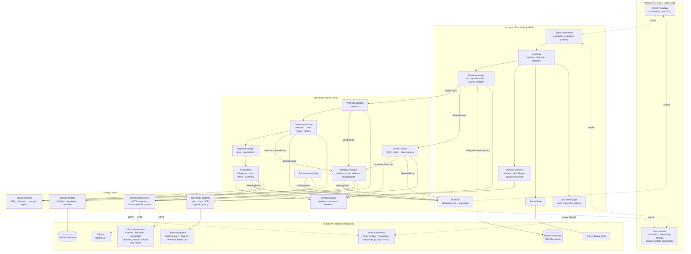

# System Architecture

Component view of OpenMeet, an interview copilot for interviewers and
workplace teams with built-in cheating detection. Top to bottom: the two React webviews, the Tauri
desktop shell (`src-tauri`), the real-time engine, the library crates, and
everything outside the OpenMeet process. Names match the code
(`docs/ARCHITECTURE.md` §1, `docs/INTERNALS.md`).

Legend: solid arrow = in-process call or data hand-off · dashed arrow = IPC or
network (HTTP on loopback or to a remote host) · cylinder = data store.

