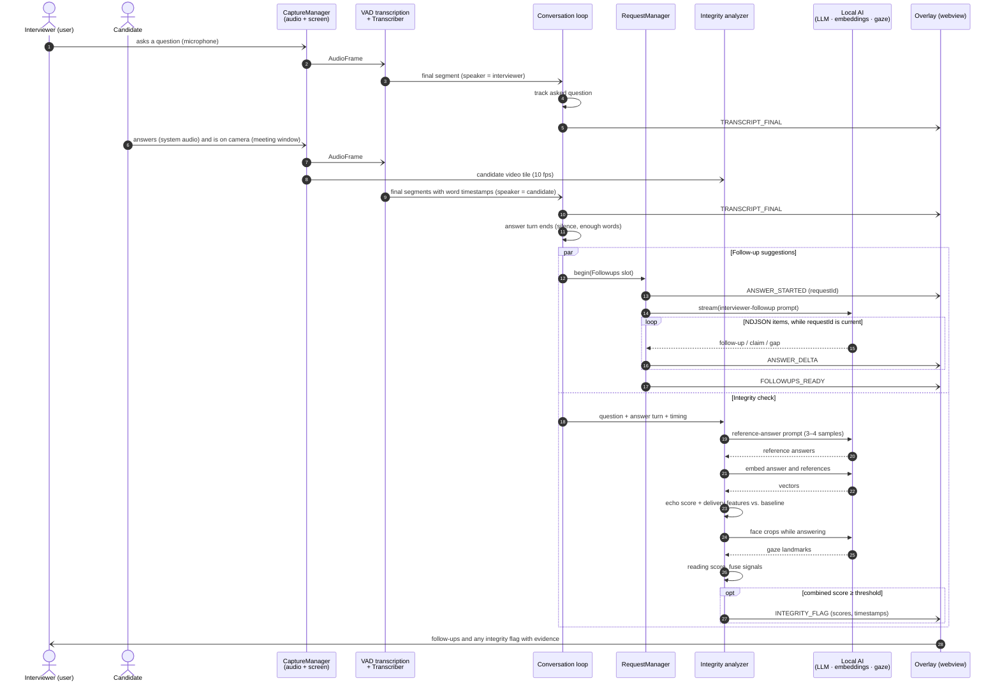

# Meeting Interaction Sequence

The interviewer asks a question, the candidate answers over the call, and
OpenMeet runs two things in parallel when the answer turn ends: grounded
follow-up suggestions, and the integrity check (AI-echo answer analysis plus
reading-gaze detection). Message names are `MeetingEvent` variants
(`crates/openmeet-core/src/events.rs`).

Notation (UML 2.5): `->>` synchronous call or message, `-)` asynchronous
signal, `-->>` reply / return, `par` fragments run concurrently.

