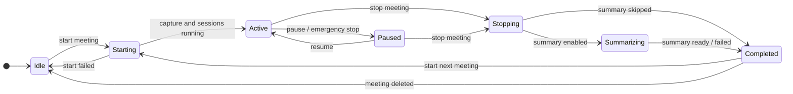
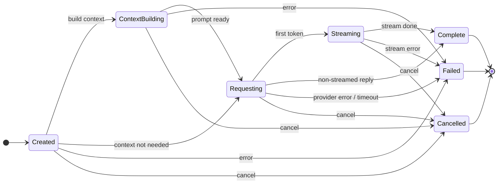

# State Machines

OpenMeet has two explicit state machines, both validated on every
transition. The overlay does not have a state machine of its own: its header
status is derived from these two (`deriveStatus` in `src/overlay/state.ts`),
and "minimal HUD" is an expand / collapse toggle the user controls, not a
state.

## Meeting lifecycle

`MeetingState::can_transition_to` in `crates/openmeet-core/src/types.rs`.

## AI request lifecycle

One machine per request (follow-ups, Ask, refinement, integrity check). `answer_transition_allowed` in
`crates/openmeet-engine/src/state.rs`. Any non-final state can fail or be
cancelled (a newer request in the same slot, dismiss, pause, emergency stop).

## Overlay status (derived, not a state machine)

| Condition, checked in order | Status shown |
|---|---|
| processing stopped (emergency stop) | Processing stopped |
| meeting `Paused` | Paused |
| a request is `Created` / `ContextBuilding` / `Requesting` | Thinking… |
| a request is `Streaming` | Drafting follow-ups… / Answering… (Ask) |
| an integrity flag was raised for the last answer | Integrity flag badge, shown next to the status |
| meeting `Active` | Listening |
| meeting `Starting` | Starting… |
| meeting `Stopping` / `Summarizing` | Ending meeting… / Writing summary… |
| meeting `Completed` | Meeting ended |
| otherwise | Ready |
