# Core Component Classes

Main Rust types and how they relate. OpenMeet is written in Rust, so a
"class" here is a struct and an «interface» is a trait; `..|>` means the
struct implements the trait. Only the most important fields and methods are
shown.

UML notation: `*--` composition (owns, same lifetime) · `o--` aggregation
(shared `Arc`, may be absent) · `-->` association · `..|>` realization
(implements a trait) · `..>` dependency.

```mermaid
classDiagram
    direction TB

    class AppState {
        +Engine engine
        +Arc~Database~ db
        +Arc~SecretStore~ secrets
        +CaptureManager capture
        +OverlayController overlay
        +ShortcutManager shortcuts
        +LocalAiManager local_ai
        +Arc~ScreenshotStore~ screenshots
    }
    class CaptureManager {
        +start_audio(...)
        +stop_audio(engine)
        +start_screen(...)
        +stop_screen(engine)
        +capture_now() bool
    }
    class OverlayController
    class ShortcutManager
    class LocalAiManager
    class SecretStore
    class TauriSink
    class ScreenshotStore {
        +save(meeting_id, frame)
        +delete_meeting(meeting_id)
        +prune(existing)
    }

    class Engine {
        +start_meeting(req)
        +stop_meeting()
        +pause()
        +resume()
        +emergency_stop()
        +push_audio(frame)
        +push_screen_frame(frame)
        +generate_followups() Id
        +assess_integrity(turn) Id
        +ask(prompt) Id
        +refine(request_id, refinement) Id
        +snapshot() EngineSnapshot
    }
    class RequestManager {
        +begin(slot, kind) RequestTicket
        +set_state(ticket, state)
        +cancel_all()
    }
    class MeetingRuntime {
        +Meeting meeting
        +MeetingStateMachine machine
        +Vec~TranscriptSegment~ segments
        +Vec~DetectedQuestion~ questions
        +Vec~Claim~ claims
        +Vec~ScreenObservation~ observations
        +TopicTracker topics
        +ContextMemory memory
        +transition(next)
    }
    class IntegrityAnalyzer {
        -SpeakerBaseline baseline
        -GazeSeries gaze
        +observe_baseline(segment)
        +push_face_frame(frame)
        +score_answer(question, answer, timing) IntegrityFlag
    }
    class IntegrityFlag {
        +f32 echo_score
        +f32 delivery_anomaly
        +f32 reading_score
        +Vec~Evidence~ evidence
    }
    class ContextMemory {
        -Bm25Index bm25
        -HashMap vectors
        +String long_term_summary
        +add(item)
        +retrieve(query)
    }
    class Persister
    class ProviderSet {
        +Option llm
        +Option fast_llm
        +Option transcription
        +Option vision
        +Option ocr
        +Option embeddings
    }
    class VadTranscriptionProvider

    class Database {
        +open(path)
        +apply_retention(policy, now)
        +delete_meeting(id)
    }
    class NullStore

    class EventSink {
        <<interface>>
        +emit(event)
    }
    class MeetingStore {
        <<interface>>
    }
    class SecretResolver {
        <<interface>>
        +api_key(provider)
    }
    class LlmProvider {
        <<interface>>
        +stream(request, cancel)
    }
    class TranscriptionProvider {
        <<interface>>
        +start_session(config, events)
    }
    class Transcriber {
        <<interface>>
        +transcribe(request, cancel)
    }
    class VisionProvider {
        <<interface>>
        +analyze(request, cancel)
    }
    class OcrEngine {
        <<interface>>
        +recognize_png(png)
    }
    class GazeProvider {
        <<interface>>
        +track(face_crop, cancel)
    }
    class EmbeddingProvider {
        <<interface>>
        +embed(texts, cancel)
    }

    AppState *-- Engine
    AppState *-- CaptureManager
    AppState *-- OverlayController
    AppState *-- ShortcutManager
    AppState *-- LocalAiManager
    AppState o-- Database
    AppState o-- SecretStore
    AppState o-- ScreenshotStore

    Engine *-- RequestManager
    Engine *-- Persister
    Engine *-- ProviderSet
    Engine *-- "0..1" MeetingRuntime : current meeting
    Engine o-- EventSink
    MeetingRuntime *-- ContextMemory
    MeetingRuntime *-- IntegrityAnalyzer
    IntegrityAnalyzer ..> IntegrityFlag : creates
    IntegrityAnalyzer ..> LlmProvider : reference answers
    IntegrityAnalyzer ..> EmbeddingProvider : echo score
    IntegrityAnalyzer ..> GazeProvider : face crops
    MeetingRuntime o-- MeetingStore
    CaptureManager ..> Engine : AudioFrame / ScreenFrame
    Persister ..> MeetingStore : writes

    ProviderSet o-- "0..1" LlmProvider
    ProviderSet o-- "0..1" TranscriptionProvider
    ProviderSet o-- "0..1" VisionProvider
    ProviderSet o-- "0..1" OcrEngine
    ProviderSet o-- "0..1" EmbeddingProvider
    ProviderSet o-- "0..1" GazeProvider
    VadTranscriptionProvider o-- "1" Transcriber

    TauriSink ..|> EventSink
    Database ..|> MeetingStore
    NullStore ..|> MeetingStore
    SecretStore ..|> SecretResolver
    VadTranscriptionProvider ..|> TranscriptionProvider
    OpenAiLlm ..|> LlmProvider
    AnthropicLlm ..|> LlmProvider
    OllamaLlm ..|> LlmProvider
    OpenAiTranscriber ..|> Transcriber
    LlmVisionProvider ..|> VisionProvider
    OcrVisionProvider ..|> VisionProvider
    WindowsOcr ..|> OcrEngine
    HashingEmbedder ..|> EmbeddingProvider
    OpenAiEmbeddings ..|> EmbeddingProvider
    OllamaEmbeddings ..|> EmbeddingProvider
    LocalAiGaze ..|> GazeProvider
```

