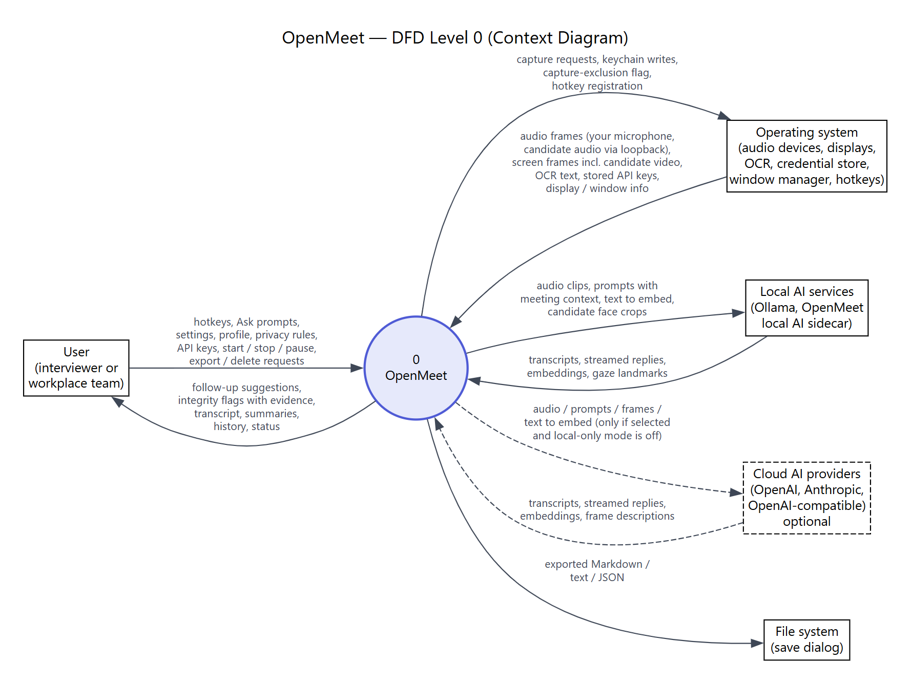
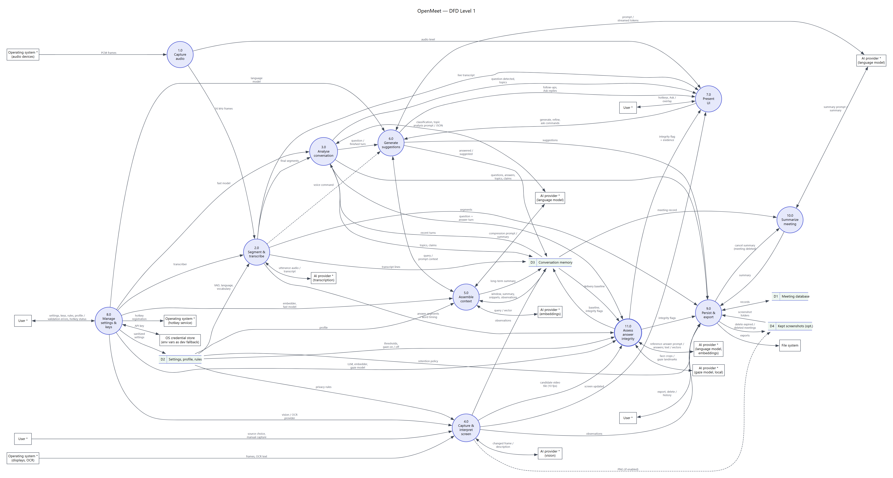
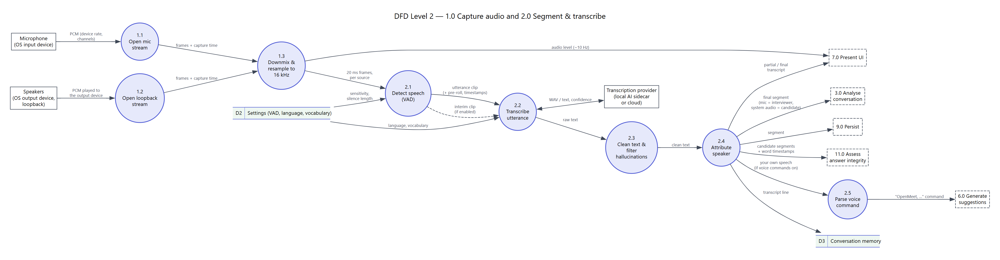
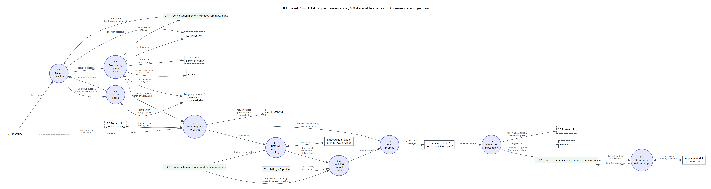
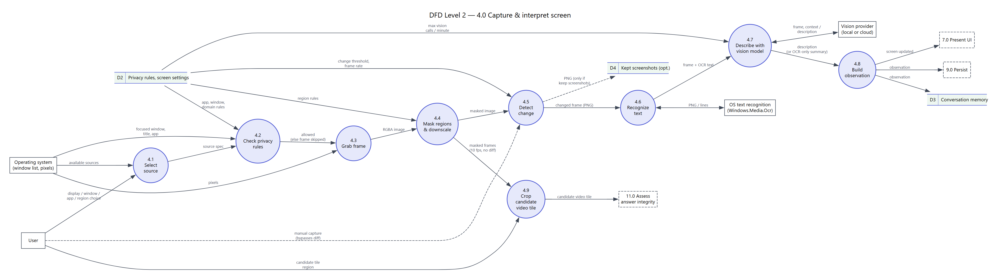
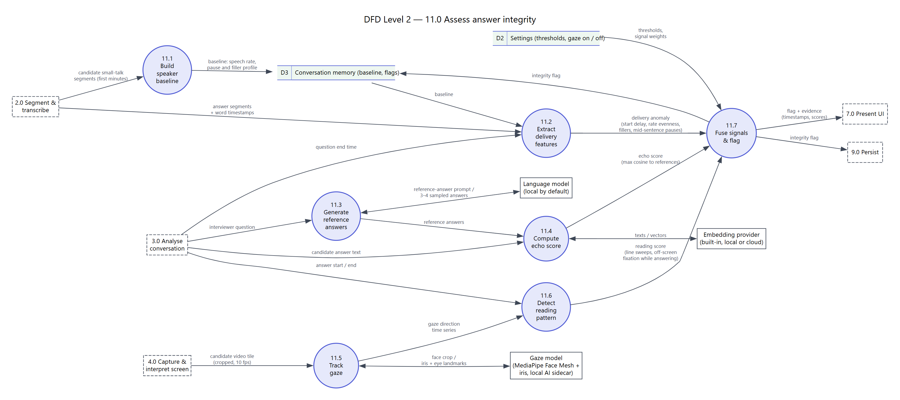
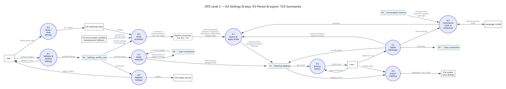

# Data Flow Diagrams

The DFDs live in [`diagrams/dfd/`](../diagrams/dfd/) as Graphviz sources
(`.dot`) with rendered PNGs. They are the only DFD set: Level 0 is the
context diagram, Level 1 splits OpenMeet into eleven numbered processes, and
each Level 2 diagram breaks down one or more Level 1 processes.

Notation (Yourdon–DeMarco):

| Symbol | Meaning |
|---|---|
| Rectangle | External entity (source or sink outside OpenMeet) |
| Circle with a number | Process |
| Box open on the right, `Dn` label | Data store |
| Arrow with a label | Data flow (a double-headed arrow is a request and its response) |
| Dashed rectangle (Level 2) | A Level 1 process outside this diagram (off-page connector) |
| Dashed arrow | Optional flow (only when the matching setting is on) |
| `*` after a name | Drawn more than once to keep arrows short |

Data stores:

| Id | Store | Physical form |
|---|---|---|
| D1 | Meeting database | SQLite tables `meetings`, `transcript_segments`, `questions`, … |
| D2 | Settings, profile, privacy rules | SQLite tables `settings`, `privacy_rules` |
| D3 | Conversation memory | In-memory `MeetingRuntime` + `ContextMemory` (window, summary, BM25 + vector index, speaker baseline, integrity flags) |
| D4 | Kept screenshots | PNG files under `<data dir>/screenshots/<meeting id>/`, opt-in |

Regenerate a PNG after editing its source (Graphviz 2.50 or later):

```bash
dot -Tpng -Gdpi=110 diagrams/dfd/dfd-level-1.dot -o diagrams/dfd/dfd-level-1.png
```

## Level 0: context diagram



## Level 1



## Level 2: 1.0 Capture audio and 2.0 Segment & transcribe



## Level 2: 3.0 Analyse conversation, 5.0 Assemble context, 6.0 Generate suggestions



## Level 2: 4.0 Capture & interpret screen



## Level 2: 11.0 Assess answer integrity (cheating detection)



## Level 2: 8.0 Settings & keys, 9.0 Persist & export, 10.0 Summarize


