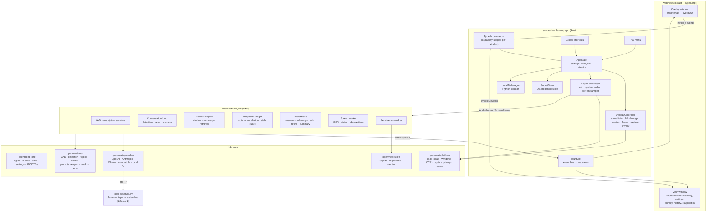
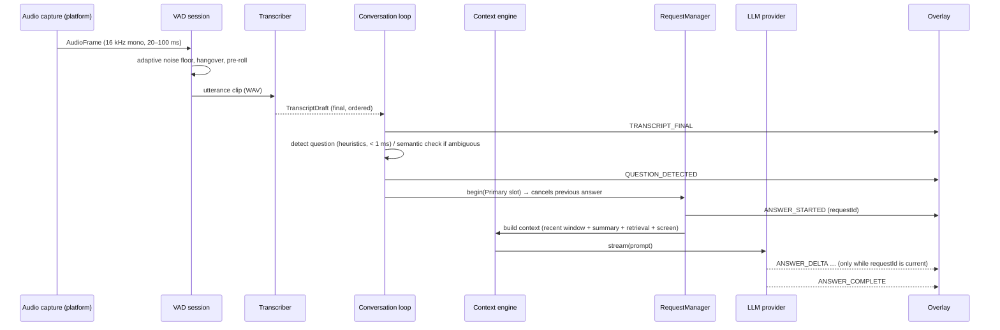
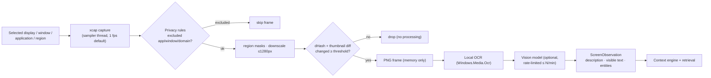
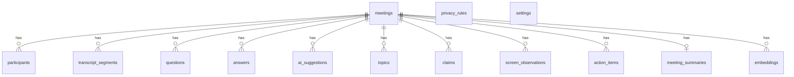
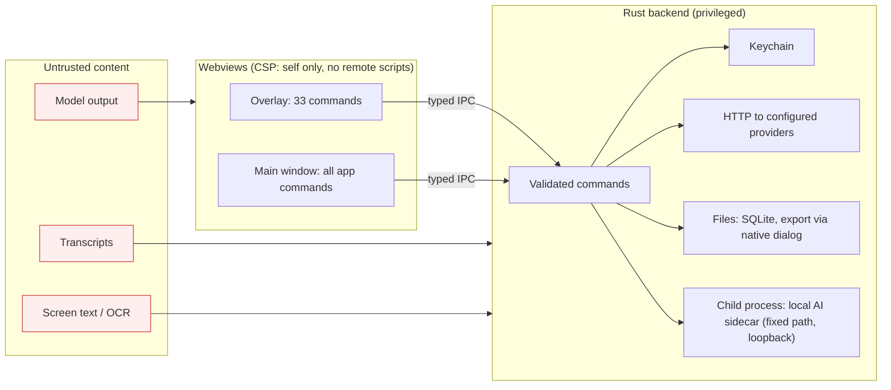

# OpenMeet architecture

OpenMeet is a desktop AI overlay that runs alongside a live meeting. It listens
to permitted audio (and, if the user opts in, a selected screen source),
transcribes it, detects questions and conversational turns, and streams
grounded suggestions into a small always-on-top overlay. The normal
application window is secondary: onboarding, settings, privacy, history and
diagnostics.

* Binding contracts between crates: [`INTERNALS.md`](INTERNALS.md)
* Frontend contract: [`FRONTEND.md`](FRONTEND.md)
* Providers: [`PROVIDERS.md`](PROVIDERS.md) · Privacy: [`../PRIVACY.md`](../PRIVACY.md) · Security: [`../SECURITY.md`](../SECURITY.md)

---

## 1. Components



| Crate | Responsibility | Depends on |
|-------|---------------|------------|
| `openmeet-core` | Domain model, `MeetingEvent` bus, provider traits, settings, IPC DTOs (exported to TypeScript with `ts-rs`), DSP helpers (resampler, WAV) | — |
| `openmeet-intel` | Pure algorithms: VAD/segmentation, question detection, voice commands, topic tracking, claims & entities, text similarity, hashing embeddings, BM25, versioned prompts + tolerant parsers, export, extractive summary, vision adapters, deterministic mocks, demo scripts | core |
| `openmeet-engine` | Real-time orchestration on tokio: transcription sessions, conversation loop, context engine & retrieval, request manager, assistant flows, screen processing, summaries, latency metrics, health, benchmark, simulation, demo | core, intel |
| `openmeet-providers` | HTTP adapters (OpenAI, Anthropic, Ollama, OpenAI-compatible, local AI sidecar), SSE/NDJSON streaming, settings → provider factory, local-only enforcement | core |
| `openmeet-platform` | OS integration: audio capture (cpal), screen capture (xcap) with change detection & privacy rules, Windows OCR, capture exclusion, focus, meeting-app detection, process stats | core |
| `openmeet-store` | SQLite persistence (rusqlite), migrations, retention, deletion, settings, privacy rules | core |
| `src-tauri` | The desktop app: windows, overlay behaviour, tray, hotkeys, keychain, sidecar management, commands, wiring | all |
| `src/` | React UI: overlay and main window | generated bindings |
| `local-ai/` | Optional Python sidecar in a virtual environment: local Whisper transcription and local embeddings | — |

## 2. Key architectural decisions

1. **The real-time engine runs in Rust, not in the webview.** Hidden or
   occluded webviews are throttled by the OS/WebView; the pipeline must keep
   running while the overlay is hidden and the main window closed. Rust also
   keeps API keys out of the renderer and gives predictable latency. The
   webviews are thin, event-driven views.
2. **Prompts live in `openmeet-intel` (Rust)**, versioned (`ID`, `VERSION`),
   unit-tested, provider-independent, with tolerant parsers — next to the code
   that sends them. Prompt text never lives in React components.
3. **Typed IPC end to end.** Rust types derive `ts-rs`; `src/bindings/` is
   generated; `src/lib/ipc.ts` wraps every command. CI fails if bindings are
   stale.
4. **Event-driven.** Every subsystem reports through `MeetingEvent` (spec §85);
   the UI never polls. One Tauri channel (`openmeet://event`) for meeting
   events, one (`openmeet://ui`) for window commands.
5. **Explicit state machines** for the meeting (`Idle → Starting → Active ⇄
   Paused → Stopping → Summarizing → Completed`) and for every AI request
   (`Created → ContextBuilding → Requesting → Streaming → Complete | Failed |
   Cancelled`), validated on every transition.
6. **Streaming everywhere.** LLM responses stream token by token; candidate
   answers use a line-oriented `[[SECTION]]` format and interviewer follow-ups
   use NDJSON so the overlay renders progressively.
7. **Batch recognizer + VAD = streaming transcription.** Utterance-level
   recognizers (OpenAI `/audio/transcriptions`, faster-whisper) are wrapped by
   `VadTranscriptionProvider`, which cuts utterances with an adaptive energy
   VAD, transcribes them concurrently, and emits finals in order (plus optional
   interim results). Any recognizer becomes a streaming provider.
8. **Local-first defaults.** Ollama for the LLM, the faster-whisper sidecar for
   transcription, Windows OCR for screen text, built-in hashing embeddings.
   Cloud providers are opt-in and labelled.
9. **Python sidecar for local speech.** faster-whisper (CTranslate2) is the
   most practical high-quality local Whisper today; it runs in an isolated
   virtual environment (`local-ai/.venv`) behind an OpenAI-compatible loopback
   API, so the Rust side uses the same client for local and cloud
   transcription.
10. **Speaker attribution from audio sources.** Microphone = the user, system
    audio = other participants. Without system audio, microphone speech is
    "unknown". This gives reliable who-asked-what without diarization models.
11. **Documented OS capture exclusion only** (spec §8), behind a
    `CapturePrivacy` trait, with honest limitation statements.
12. **Non-activating overlay.** The overlay window is created
    `focusable(false)` (→ `WS_EX_NOACTIVATE` on Windows), so clicks do not
    steal focus from the meeting app; typing temporarily makes it focusable and
    hands focus back afterwards.

## 3. Real-time data flow



Latency is tracked per stage (spec §53): audio → transcript, transcript →
detection, request → first token, first token → complete, screen processing,
overlay render (reported by the UI). Diagnostics shows last / p50 / p95 / max.

### Audio pipeline

1. **Capture** (`openmeet-platform::audio`): cpal stream on a dedicated thread
   (cpal streams are `!Send` on some hosts), any sample format → f32 → mono
   downmix → streaming resampler to 16 kHz. Microphone via the selected input
   device; system audio via WASAPI loopback (Windows), monitor sources
   (PulseAudio/PipeWire on Linux) or the platform mechanism on macOS where
   available.
2. **Routing** (`engine::audio_router`): frames go through a bounded queue
   (drops are counted and surfaced as degraded health — never blocking the
   audio thread) to the session of their source.
3. **Segmentation** (`intel::vad`): 20 ms frames, RMS energy against an
   adaptive noise floor, minimum speech duration, silence hangover (default
   700 ms), 240 ms pre-roll, discard of too-short blips, forced cuts for long
   speech at a low-energy frame.
4. **Recognition** (`VadTranscriptionProvider`): up to 2 concurrent requests
   per source, 30 s timeout, results re-ordered by utterance sequence, interim
   results never emitted after a final, the previous transcript tail and
   vocabulary passed as a biasing prompt, Whisper silence hallucinations
   ("Thank you.", "Thanks for watching") filtered only when the audio really
   was quiet.

### Conversation understanding

* **Question detection** (`intel::detect`): punctuation (when present),
  WH-starts, auxiliary inversion, imperative prompts ("walk me through…"),
  embedded questions, tag questions, multi-part splitting, lead-in merging,
  continuation (`supersedes`), speaker role, false-positive filters (reported
  speech, "the question I was thinking about was…", rhetorical
  self-answers, fillers), 13 categories. Ambiguous cases can be confirmed by a
  short LLM classification (`question-detection` prompt) when enabled.
* **Answer tracking**: after a detected question, the other side's speech is
  collected as the answer (`AnswerRecord`) and becomes retrievable context.
* **Interviewer turns**: candidate speech accumulates into a turn; when the
  candidate stops for `turn_end_silence_ms` and the turn has enough words,
  follow-ups are generated.
* **Topics** (`intel::topics`): taxonomy + planned topics, current / covered /
  pending, suggested next area; periodically refined by an LLM topic analysis.
* **Claims & action items** (`intel::claims`): technologies, metrics,
  decisions, trade-offs, ownership, risks; action-item phrases.
* **Voice commands** (optional): "OpenMeet, explain that / give me a
  follow-up / make that concise / …" from the user's microphone.

### Context engine (spec §18, §19, §52)

```
Last N minutes (default 3):        raw transcript (speaker-labelled)
Earlier conversation:              rolling compressed summary (LLM, or extractive fallback)
Important facts:                   claims, topics, asked questions, previous follow-ups
Relevant history:                  hybrid retrieval (BM25 + embeddings + recency, top 6)
Screen:                            latest observations (first when the question says "this/that/here/the diagram…")
User context:                      profile notes (background, role, planned topics)
```

`render_context` assembles these into delimited data blocks within a token
budget (default 3,500), trimming by priority. Compression runs in the
background once ~900 tokens of transcript have aged out of the raw window.
Embeddings are computed in batches by the configured embedding provider (or the
built-in hashing embedder) and stored with the model id; vectors of different
models are never mixed.

### Request orchestration (spec §55, §56)

* UI **slots**: `Primary` (answers, Ask, refinements, clarifications) and
  `Followups`; starting a request in a slot cancels the previous one.
* Every streamed event is emitted only if its request is still the current one
  for its slot, and that check happens under the same lock as the slot switch —
  a stale answer can never be interleaved after a newer `ANSWER_STARTED`.
* The frontend applies the same rule (latest request id per slot), so stale
  responses are filtered twice.
* Every request carries a `CancellationToken`; providers abort the HTTP stream
  when it fires. Pause cancels UI requests; emergency stop cancels everything.
* Background requests (compression, classification, topic analysis, screen
  analysis, summary) never block the UI slots.

### Candidate and interviewer flows

* **Candidate**: question detected (remote speaker, requires response,
  confidence ≥ threshold) → automatic suggested answer in the selected style
  (Concise, Detailed, Technical, Simple, STAR, Example-driven, Step-by-step);
  controls: Regenerate, Shorter, Longer, More technical, Simplify, Give
  example, Show reasoning (a short user-facing rationale — never hidden
  chain-of-thought), Copy, Pin, Dismiss. The prompt forbids inventing personal
  history and requires marking inference vs. framing; insufficient context →
  explicit caveat.
* **Interviewer**: candidate turn ends → NDJSON follow-ups grounded in the
  candidate's words, each with category, priority, trigger statement and a
  short reason; semantic duplicate filtering against asked questions and
  earlier suggestions (lexical paraphrase similarity + embedding cosine);
  claims, gaps and topics captured along the way. Never evaluative.

### Screen pipeline (spec §13, §26–§30)



Identical frames are never re-processed; the engine keeps only the latest
pending frame (a `watch` channel), so a slow vision model never builds a
backlog. Raw frames are discarded after analysis unless the user explicitly
enables screenshot retention.

## 4. State management

* **Rust**: `Engine` owns the meeting runtime behind a mutex (short critical
  sections; no awaits while locked), the request manager, health registry and
  latency tracker. `AppState` (desktop) owns settings persistence and OS
  resources. Settings are sanitized + validated in Rust, then applied
  (providers rebuilt, overlay relaid, hotkeys re-registered, autostart, capture
  privacy, retention).
* **Frontend**: one Zustand store per window. The overlay store is driven by a
  pure reducer (`reduceOverlay`) over `MeetingEvent`s; the main window store
  holds settings (optimistic updates with rollback) and a live view reduced
  from the same events. Windows (re)hydrate with `get_snapshot`.

## 5. Database model

SQLite (WAL, foreign keys, `secure_delete`), migrations via `PRAGMA
user_version`. All meeting-owned rows reference `meetings(id) ON DELETE
CASCADE`.



No raw audio and no screenshots are stored in the database. Retention runs at
start-up and hourly; "do not retain" meetings use a `NullStore` and never touch
disk.

## 6. Overlay architecture

* Separate Tauri window (`overlay.html`, own small bundle): transparent,
  frameless, always-on-top, skip-taskbar, visible on all workspaces,
  non-activating, resizable by content (the UI measures its card and calls
  `overlay_set_size`; height is capped and content scrolls).
* Position: corners or custom; custom positions are remembered per display
  (keyed by name + resolution) and per meeting application on that display,
  relative to the display's work area (taskbar/dock aware), DPI-scaled margins,
  clamped on-screen. Target display or "separate display" layout for
  multi-monitor setups.
* Click-through: `set_ignore_cursor_events`.
* Typing (Ask OpenMeet): the backend records the foreground window, makes the
  overlay focusable and focuses it; on submit/escape it restores
  non-activation and returns focus to the meeting app.
* States: hidden, idle, listening, processing, question + streaming answer,
  follow-ups, minimal HUD, paused, processing stopped, errors.

## 7. OS-specific integrations

| Concern | Windows | macOS | Linux |
|---------|---------|-------|-------|
| Microphone | WASAPI (cpal) | Core Audio (cpal) | ALSA / PulseAudio (cpal) |
| System audio | WASAPI loopback | platform mechanism where supported, otherwise a virtual device (e.g. BlackHole) | PulseAudio/PipeWire monitor sources |
| Screen capture | xcap (Windows Graphics Capture / GDI) | xcap (ScreenCaptureKit / CoreGraphics), Screen Recording permission | xcap (X11 / Wayland portal) |
| OCR | Windows.Media.Ocr (local) | — (use a vision model) | — (use a vision model) |
| Capture exclusion | `SetWindowDisplayAffinity(WDA_EXCLUDEFROMCAPTURE)` | `NSWindow.sharingType = .none` | not supported |
| Non-activating overlay | `WS_EX_NOACTIVATE` via Tauri `focusable(false)` | non-focusable panel behaviour | WM-dependent |
| Focus hand-back | `SetForegroundWindow` | best effort | best effort |
| Credentials | Credential Manager | Keychain | Secret Service |

## 8. Security boundaries



* Model output is untrusted text: rendered as text, never HTML; the model has
  no tools and cannot trigger actions.
* Transcripts/screen text are data blocks in prompts, never instructions.
* The renderer cannot start processes, read files or make network requests
  (CSP `connect-src` is IPC only; no fs/shell/http plugins exposed).
* Window capabilities: the overlay cannot change settings, read history,
  manage keys, delete data or use developer tools.
* Developer simulation commands additionally require developer mode.

## 9. Privacy boundaries

* Capture only during an explicit meeting; pause releases devices; emergency
  stop halts everything and hides the overlay.
* Local vs. remote is computed from actual endpoints; local-only mode refuses
  remote providers; the data-flow report and its "No meeting data leaves this
  device." statement are derived from the live provider set.
* Raw audio never touches disk; screenshots only with explicit opt-in.
* Logs carry ids/counts/sizes/durations only.

See [PRIVACY.md](../PRIVACY.md).

## 10. Provider abstraction

`openmeet-core::providers` defines `LlmProvider` (streaming), `Transcriber`
(utterance), `TranscriptionProvider` (session-based streaming),
`VisionProvider`, `OcrEngine`, `EmbeddingProvider`, plus `ProviderSet` (any
member may be absent). Adapters live in `openmeet-providers` (HTTP),
`openmeet-intel` (vision wrappers, hashing embeddings, mocks) and
`openmeet-platform` (OCR). The factory maps settings → providers and enforces
local-only mode. The engine never references a concrete provider. This is the
seam for a future plugin system (transcription, LLM, vision, knowledge source,
export providers). Details: [PROVIDERS.md](PROVIDERS.md).

## 11. Failure modes and resilience (spec §66, §92)

| Failure | Behaviour |
|---------|-----------|
| LLM unavailable / rate limited / refused | Request fails visibly in the overlay ("AI provider unavailable. Check provider settings.") with Retry; transcription, detection, storage continue; health → degraded/error |
| Transcription provider down | Per-utterance errors (throttled notice), sessions keep running, manual Ask still works; local sidecar auto-started when needed |
| Microphone / device disconnected | Capture error surfaces as "Microphone unavailable. Select another audio source."; other sources continue |
| Screen permission denied / capture error | Screen health error with guidance; audio pipeline unaffected |
| Vision model slow / failing | Latest-frame-only queue, rate limit, timeout; OCR-only observation fallback |
| Embedding provider down | Keyword (BM25) retrieval continues; health degraded |
| Database error at start-up | In-memory database, explicit error status; the assistant keeps working |
| Database write failure | Persistence worker reports an error notice once per minute; meeting continues |
| Audio pipeline overload | Bounded queue drops frames (counted, health degraded) instead of blocking capture |
| Hotkey already taken | Shown per shortcut with the reason; app keeps working |
| Crash mid-meeting | Next start marks interrupted meetings completed (crash recovery) |
| Summary generation fails | Extractive summary fallback (no LLM) with a notice |

## 12. Testing strategy

* Unit tests in every crate (VAD with synthetic signals, detection tables,
  prompt builders and parsers, request manager races, state machines, SQLite
  migrations/retention/cascades, provider HTTP mapping against local mock
  servers, change detection, privacy rules, geometry).
* Engine integration tests with deterministic mocks (`MockTranscriber`,
  `MockLlmProvider`, `MockVisionProvider`, `MockEmbeddingProvider`):
  audio → VAD → transcription → detection → context → LLM → overlay events;
  candidate transcript → interviewer analysis → follow-ups; stale-answer
  cancellation; emergency stop; failures; persistence and retention; screen
  fusion; demo mode; benchmark.
* Hardware tests (`#[ignore]`) for real devices, screens, OCR and capture
  exclusion.
* Frontend: reducer and helper unit tests, render tests with mocked IPC.
* Sidecar: pytest with injected fake backends + CUDA-fallback test.
