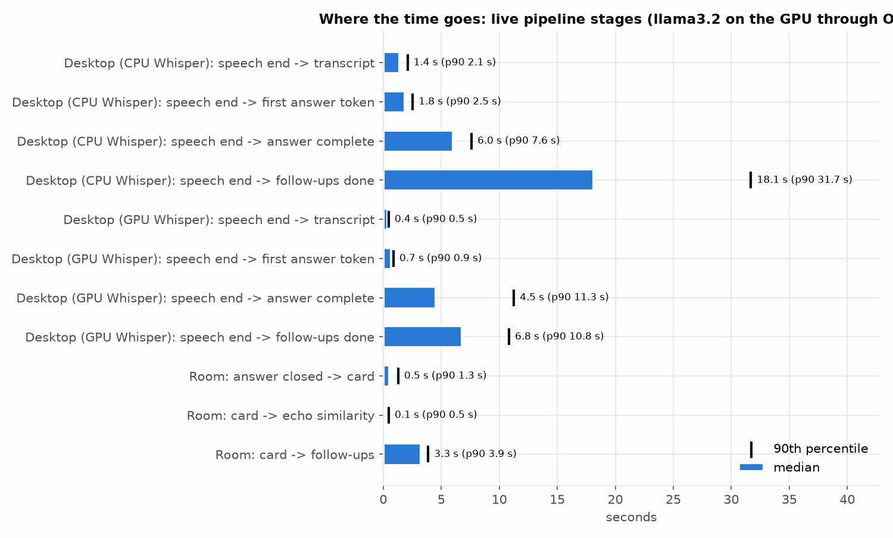
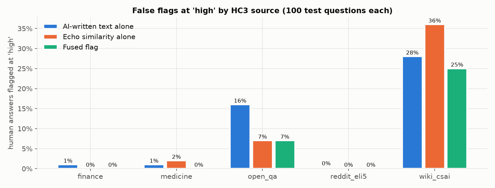

# Benchmarks

What OpenMeet's local pipeline costs in time on one laptop, how accurate its
transcription is, and how often the answer-integrity check catches AI
answers and flags honest ones. This is objective O4 of the project ("test
latency, transcription accuracy, detection rate and false flags; ablate").

Every number in the tables below is printed from a result file in
[`benchmarks/results/`](../benchmarks/results) by
[`benchmarks/tables.py`](../benchmarks/tables.py)
(`python benchmarks/tables.py --doc docs/BENCHMARKS.md --check` fails if
they differ). The numbers written in the text are checked against the result
files by [`benchmarks/check_doc.py`](../benchmarks/check_doc.py). The scripts,
their inputs and how to run them are in [Reproduce](#reproduce). Read
[Limits](#limits) before quoting a number.

## Summary

- **Transcription.** On 600 LibriSpeech utterances, Whisper `base.en` (the
  sidecar's default) makes 3.9% word errors on test-clean and 10.7% on
  test-other. Its median request takes about 0.41 s on the CPU and 0.09 s on the
  GPU for a clip of about 7 s on average (section 1).
- **Live pipeline.** In the desktop engine, real-time spoken questions are
  detected and the answer starts streaming well under a few seconds after the
  speaker stops (section 2; the tables give the medians and percentiles).
- **AI-written text.** The shipped model (v2) and the first model (v1) each
  catch 97.8% of ChatGPT answers at their `high` level on the HC3 test
  questions, and flag 1.8% (v2) and 2.0% (v1) of human answers (section 3).
- **Fused flag** (two of the four signals, on HC3). At `high` it catches 80.0%
  of ChatGPT answers and flags 4.7% of human ones. At `possible` it catches
  99.6% and flags 25.0%. Neither level is a verdict. The textbook-style source
  (wiki_csai) is the weak spot: 25% of its human answers are flagged at `high`.

## Machine and software

All runs: one laptop, 13th Gen Intel Core i9-13900H (14 cores, 20 logical
CPUs), 16 GB RAM (15.7 GB visible), NVIDIA GeForce RTX 4060 Laptop GPU
(8 GB, driver 621.24), Windows 11 Home (build 26300), Python 3.11.9, Rust
1.99.0, Ollama serving `llama3.2` (3.2B, Q4_K_M) on the GPU. Each table ends
with its own run's date, commit and package versions. Another build (a Rust
compile in another folder) sometimes ran on the same machine at the same time;
CPU timings can be a little slower than on an idle machine.

Defaults unless a table says otherwise: Whisper `base.en` with int8 weights,
greedy decoding (beam 1) and faster-whisper's 4 CPU threads, as the sidecar
ships; embeddings `BAAI/bge-small-en-v1.5` (fastembed, ONNX); follow-ups and
reference answers from `llama3.2` at the room's settings. Latencies are
wall-clock times seen by the caller, reported as median / 90th / 95th
percentile; a model's first (loading) request is reported separately and left
out of the percentiles.

## 1. Transcription accuracy and speed

**How.** A seeded random 300 utterances from each of LibriSpeech test-clean
and test-other (`random.Random(2026).sample` over the sorted utterance ids;
CC BY 4.0, from openslr.org) went one at a time through the sidecar's real
endpoint, `POST /v1/audio/transcriptions`, as 16 kHz 16-bit WAV with
`language=en` and no prompt. A fresh sidecar was started for each model, so
only one Whisper model was in memory. Word error rate (WER) uses OpenAI
Whisper's English text normaliser on both sides (the `whisper_normalizer`
package, a copy of `whisper/normalizers/english.py`), with the errors summed
over the whole subset. Latency is the HTTP request's wall time; the real-time
factor (RTF) is latency divided by the audio's length (0.05 = 20 times faster
than real time). The GPU runs used the same sidecar with CUDA 12 cuBLAS and
cuDNN 9 from NVIDIA's pip wheels on its `PATH` (the sidecar needs them for
`OPENMEET_WHISPER_DEVICE=cuda`; nothing in the product changed). Source:
`benchmarks/results/asr_cpu.json`, `asr_cuda.json`, `asr_cpu_words.json`.

<!-- tables:asr -->
<!-- /tables -->


The word-timestamp run (verbose output, which the room asks for) uses a
different, smaller sample (100 utterances per split), so its latency is not
directly comparable with the plain CPU run; in the tables it is about 2.4
times the plain CPU median.

## 2. Pipeline latency

Three views of the same pipeline:

- **The desktop engine** (Rust). Its own Diagnostics benchmark
  (`Engine::run_benchmark`: synthetic input, a mock LLM, so it times the
  engine's own work), run 20 times headless; then the real pipeline with local
  models, as `crates/openmeet-engine/tests/live.rs` runs it: 12 spoken
  interview questions (Windows text-to-speech, 2.5-4.9 s each) pushed into the
  engine as 20 ms system-audio frames **in real time**, through voice activity
  detection, the sidecar's Whisper (`base.en`, on the CPU and then on the GPU),
  question detection and llama3.2 on the GPU writing the suggested answer; then
  12 spoken candidate answers in interviewer mode (follow-up questions) and the
  meeting summary. Times are measured from the moment the last speech frame was
  pushed, so they include the VAD's 700 ms silence hangover (and, for
  follow-ups, the 1.5 s turn-end wait), which a user waits for too. Both use
  only the engine's public API, from a separate crate
  ([`benchmarks/engine-bench`](../benchmarks/engine-bench)).
- **The sidecar's endpoints** one at a time: embeddings, the AI-written-text
  model, one video frame through the gaze tracker (MediaPipe) at 10 frames a
  second, and the reading network.
- **The interview room** end to end: a scripted 8-answer interview played
  against the room's HTTP API in real time, following the host page's own rules
  (speech cut into pieces by a Python copy of its segmenter, a video frame 10
  times a second, the answer closed when the interviewer speaks again, then echo
  similarity and follow-ups requested together, as `host.html` does). Whisper
  `base.en` on the CPU (the room's default), follow-ups and reference answers
  from llama3.2.

<!-- tables:engine -->
<!-- /tables -->

<!-- tables:sidecar -->
<!-- /tables -->

<!-- tables:followups -->
<!-- /tables -->

<!-- tables:room -->
<!-- /tables -->



The live engine numbers are the desktop app's own pipeline on this machine;
the room numbers come from the room's HTTP API and include its browser-side
requests through the sidecar and Ollama. The latency to the first answer token
is what the candidate sees first; the complete answer follows after it.

## 3. Detection rate and false flags

A flag is a reason for the interviewer to ask a follow-up question, never a
verdict. "Detection rate" is the share of AI answers (or reading windows)
flagged, "false-flag rate" the share of honest ones flagged, at the spec's
two levels: `possible` (the lower threshold) and `high` (the higher one). Every
threshold below was chosen on development data before these test sets were
scored.

<!-- tables:held_out -->
<!-- /tables -->

These were measured when each model was built; the table only gathers them
(details in [MODELS.md](MODELS.md) and each `training/*/README.md`). Read them
with their caveats:

- **Reading** is near perfect on GazeBase, which is lab eye tracking (a chin
  rest, silent poem reading) made noisy to look like a webcam; in its hardest
  condition (small face, heavy noise) about 28% of non-reading windows are
  flagged at `possible`. The real-life figure (Reading in the Wild) is for a
  model trained on those people's data, not the shipped GazeBase network,
  which has not been scored there yet.
- **AI-written text** is measured on HC3's written answers; the per-source
  table below shows it flags more human answers on textbook-style questions
  than the all-sources figure suggests.
- **Echo similarity** is the same 500 test questions as the fusion table below.
- **Delivery** is close to chance on SpiCE and flags spontaneous speech
  slightly more often than read speech; it stays uncalibrated, so the fused
  flag counts it at most as `possible`.

### The AI-written text model: v1 and v2

The shipped model is v2. It was retrained (commit 0ca0fad) on HC3 plus 54
interview-style Q&A pairs. **Correction to the spec:** v2 does store held-out
test metrics. Its `test_questions` field holds the metrics on the HC3 test
questions, nested under `balanced` and `low_false_positive`, as its training
script computed them. The numbers below use those stored values and check them
against a fresh recomputation (the stored-versus-recomputed table below); the
two agree to two decimals.

**Leakage check.** `training/echo-detection/retrain_with_interviews.py` splits
HC3 with the same function and seed as `train_content.py` (seed 2026: 20% of
questions are test; the 15% validation split uses seed 2027). The interview
questions carry ids offset by 100,000, so they cannot share a question with
HC3. No interview question, and no interview answer (first 200 characters),
appears among the HC3 test questions or answers. So the test questions were
not used for training or for choosing thresholds.

**Reproducibility.** Rerunning `retrain_with_interviews.py` on this machine
does **not** reproduce the committed v2 bit for bit. The rerun's
output is `benchmarks/results/retrain_v2_rerun.json`: its thresholds are
0.4900 / 0.2476 for HC3 against 0.4624 / 0.2466 in the committed file (its
interview thresholds differ too), and its vocabulary differs from the committed
file's by 407 of the 60,000 terms (a one-off comparison of the two model files,
not a script in this folder).
Every number for v2 in this document is for the committed file as shipped
(`local-ai/integrity/models/echo_tfidf.json`), not for a fresh retraining. The
cause of the difference was not found. v1's stored test metrics are reproduced
with the same split code, to two decimals.

<!-- tables:ai_text -->
<!-- /tables -->




**How** ([`benchmarks/bench_fusion.py`](../benchmarks/bench_fusion.py)).
HC3 has two of the four signals: the transcript text (`ai_text`, the sidecar's
AI-text model, scored with the sidecar's own code) and echo similarity (the
answer against llama3.2's two reference answers, embedded with bge-small,
exactly as the room computes it). The answers are the 1,411 answers to the
same 500 test questions (100 per source) the echo calibration scored, with its
cached reference answers; both models' test questions come from the same split
(`train_content.py`, seed 2026), so no answer here was used to fit a model or
choose a threshold. Each answer gets both levels and the spec's fused flag
(`local-ai/integrity/signals.py` `fuse`: `high` only when a calibrated signal
is `high` and another is at least `possible`). The table above uses v2; v1 was
run through the same benchmark (`--ai-model`, `fusion_hc3_v1.json`).

**What it shows** (v2).

- **Fusion does what the spec intends at `high`: fewer false flags at a modest
  cost in detection.** The fused flag at `high` flags 4.7% of human answers
  (AI text alone 6.8%, echo alone 6.6%) and still catches 80.0% of ChatGPT
  answers, because a `high` now needs both signals to agree.
- **At `possible` it does the opposite.** Either signal raising `possible`
  raises the flag, so the fused flag catches 99.6% but flags 25.0% of honest
  answers, more than either signal alone.
- **One signal alone can never reach `high`** (the rows "only available"): in
  rules mode, where echo similarity is unavailable, the text model's `high`
  becomes `possible` and the flag never says "several signals agree".
- **The AI-text model is weaker on this 100-per-source sample than on its full
  test set:** 6.8% false flags at `high` here against 1.8% on all HC3 test
  questions. The full test set is mostly reddit_eli5, where it flags about 1%;
  on open_qa it flags 16% of this sample's human answers at `high` and on
  wiki_csai 28%.
- **Textbook questions stay the hard case.** On wiki_csai (computer-science
  definitions, the most interview-like source) the fused flag still flags 25%
  of human answers at `high` and 80% at `possible`. HC3's "human" answers there
  are Wikipedia text, which reads much like an LLM's; a spoken answer would
  differ more, but this is the warning for factual technical questions.
- **Two reference answers beat one** (echo alone ROC-AUC 0.876 against 0.859;
  46.7% against 37.7% caught at `high`). With one reference the thresholds,
  measured for two, flag less: fewer false flags (3.8% fused at `high`) but
  fewer detections (72.5%).

<!-- tables:fusion -->
<!-- /tables -->

## 4. Ablations

The AI-text model version (v1 against v2, in section 3), the number of echo
reference answers (one against two, in section 3) and each signal on its own
(in the fusion table) are the ablations. Follow-ups compare the local LLM with
the rules engine; see section 2.

## 5. Problems found

- **Spec premise corrected:** v2 stores held-out test metrics under nested
  keys; the spec said it did not.
- **`tables.py` crashed on v2**: its held-out table read v1's flat layout. It
  now reads `ai_text_v1_vs_v2.json`.
- **The fusion results file was v1** until it was rerun with v2. The v1 rerun
  reproduces the numbers committed with 79dbf40 exactly.
- **The committed v2 model is not reproducible from the repository's script on
  this machine** (section 3).
- **Ollama stopped responding during the live engine run** (the first attempt
  failed with connection refused). The Ollama server was restarted and the run
  repeated from the beginning; the reported numbers come from that complete
  repeat.

## Limits

- **One machine.** Every timing is from one laptop (above); a laptop CPU's
  speed also depends on its power plan and temperature, which were not
  controlled. Treat latencies as this machine's, not as guarantees.
- **Read speech and synthetic voices.** LibriSpeech is audiobook speech, far
  cleaner and more fluent than an interview over a video call; expect higher
  WER in meetings (accents, crosstalk, compression, jargon). The pipeline and
  room runs speak with Windows' built-in voices, which Whisper finds easy.
- **No prompt.** The desktop app passes the previous transcript and the
  vocabulary to Whisper as a prompt; these runs send none, so they show the
  model alone.
- **HC3 is not an interview.** Its "AI" answers are 2022 ChatGPT's, its
  "human" answers are written (Reddit, Wikipedia, medical and finance Q&A
  sites), and the two text signals see the written text, not a speech
  transcript of it. The fused-flag numbers use two of the four signals:
  reading and delivery need video and audio that HC3 does not have, so how the
  full four-signal flag behaves in a real interview is still unmeasured. Our
  own labelled recordings (`training/data-collection`) are what will settle
  the thresholds.
- **The room and engine runs are small.** 8 answers in the room and 12
  questions and 12 answers in the engine are enough for latency medians, not
  for tail percentiles (a p95 of 8 values is close to the maximum) and not for
  accuracy; their levels are a sanity check.
- **Quality of follow-up questions** is measured only by the room's own
  guardrails (how many suggestions survive them), not by people.
- **Not measured:** the cloud providers (no API key was used, commands above),
  the desktop app's overlay render time and screen/OCR processing (they need
  the GUI and a display), and the reading signal on real faces (the gaze
  benchmark sends one still photo, which times the tracker but says nothing
  about accuracy).

## Reproduce

From the repository root, with Python 3.10-3.12 and, for section 2's engine
runs, Rust. Datasets and downloaded models stay outside the repository; the
paths below are the ones used here.

**Environment.**

```bash
python -m venv venv-bench
venv-bench/Scripts/pip install -r local-ai/requirements.txt -r local-ai/requirements-integrity.txt -r benchmarks/requirements.txt
# GPU transcription only: CUDA 12 cuBLAS + cuDNN 9 in a folder of their own (about 2 GB)
venv-bench/Scripts/pip install --target M:/openmeet-work/cuda-libs nvidia-cublas-cu12 "nvidia-cudnn-cu12>=9,<10"
ollama pull llama3.2                     # Ollama on 127.0.0.1:11434
export OPENMEET_BENCH_TMP=M:/openmeet-work/tmp/bench HF_HOME=M:/cache/hf   # logs, Hugging Face cache
```

**Data** (public, no login).

```bash
python benchmarks/librispeech.py --root M:/openmeet-data/librispeech        # test-clean + test-other, md5-checked (674 MB)
python benchmarks/make_inputs.py speech --out M:/openmeet-data/bench-speech  # Windows text-to-speech of data/*.json
curl -L -o M:/openmeet-data/faces/astronaut.png \
  https://raw.githubusercontent.com/scikit-image/scikit-image/v0.24.0/skimage/data/astronaut.png  # NASA, public domain
```

The sidecar's model folder is `M:/openmeet-data/models`. Whisper downloads
there on first use. The bge-small embedding model is read from
`models/embeddings` (copy it from the echo calibration's fastembed cache, or
let the first run download it). The face landmarker is downloaded there on
first gaze use.

HC3 (`all.jsonl`) and the cached llama3.2 reference answers come from the echo
calibration (`training/echo-detection/calibrate_similarity.py`, which downloads
HC3 and writes the cache); the fusion benchmark never generates a missing
reference. `data/llm_answers.json` was written once with
`python benchmarks/make_inputs.py llm-answers` and is committed as used.

**Runs** (each writes `benchmarks/results/<name>.json`; servers use ports 8795
and 8463 and are stopped at the end).

```bash
M=M:/openmeet-data/models   # where the sidecar keeps Whisper, bge-small and the face model
python benchmarks/bench_asr.py --root M:/openmeet-data/librispeech --device cpu --n 300 --model-dir $M --out benchmarks/results/asr_cpu.json
python benchmarks/bench_asr.py --root M:/openmeet-data/librispeech --device cuda --cuda-libs M:/openmeet-work/cuda-libs --n 300 --model-dir $M --out benchmarks/results/asr_cuda.json
python benchmarks/bench_asr.py --root M:/openmeet-data/librispeech --device cpu --n 100 --models base.en --word-timestamps --model-dir $M --out benchmarks/results/asr_cpu_words.json
python benchmarks/bench_ai_text.py --data M:/openmeet-data/hc3/all.jsonl --v1 M:/openmeet-work/tmp-t04/echo_tfidf_v1.json   # v1 = git show 0836f1e:local-ai/integrity/models/echo_tfidf.json
python benchmarks/bench_fusion.py --data M:/openmeet-data/hc3/all.jsonl --cache M:/openmeet-data/hc3/cache
python benchmarks/bench_fusion.py --data M:/openmeet-data/hc3/all.jsonl --cache M:/openmeet-data/hc3/cache --ai-model M:/openmeet-work/tmp-t04/echo_tfidf_v1.json --out benchmarks/results/fusion_hc3_v1.json
python benchmarks/bench_sidecar.py --face M:/openmeet-data/faces/astronaut.png --model-dir $M
python benchmarks/bench_followups.py
python benchmarks/bench_room.py --speech M:/openmeet-data/bench-speech --face M:/openmeet-data/faces/astronaut.png --model-dir $M
CARGO_TARGET_DIR=M:/openmeet-work/target-bench python benchmarks/bench_engine.py offline --runs 20 --out benchmarks/results/engine_offline.json
CARGO_TARGET_DIR=M:/openmeet-work/target-bench python benchmarks/bench_engine.py live --speech M:/openmeet-data/bench-speech --device cpu --model-dir $M --out benchmarks/results/engine_live_cpu.json
CARGO_TARGET_DIR=M:/openmeet-work/target-bench python benchmarks/bench_engine.py live --speech M:/openmeet-data/bench-speech --device cuda --cuda-libs M:/openmeet-work/cuda-libs --model-dir $M --out benchmarks/results/engine_live_cuda.json
python benchmarks/plot.py                                   # charts
python benchmarks/tables.py --doc docs/BENCHMARKS.md        # this document's tables
python benchmarks/check_doc.py                              # every number in the text against its result file
python -m pytest -q benchmarks                              # smoke tests: synthetic, no network, GPU or data
```

**Cloud comparison (not run: no API key was used).** With a key in the
environment, the same scripts measure the cloud providers on the same inputs:

```bash
# OpenAI transcription on the same 600 LibriSpeech utterances
OPENAI_API_KEY=... python benchmarks/bench_asr.py --root M:/openmeet-data/librispeech --n 300 --device auto \
  --endpoint https://api.openai.com/v1/audio/transcriptions --api-key-env OPENAI_API_KEY \
  --models gpt-4o-mini-transcribe --out benchmarks/results/asr_openai.json
# The room's online mode (Gemini) on the same 12 answers
OPENMEET_GEMINI_API_KEY=... python benchmarks/bench_followups.py --mode online --out benchmarks/results/followups_online.json
```

`--endpoint` sends exactly the requests the local runs send, to any
OpenAI-compatible server; it was checked here against the local sidecar with a
bearer token. Echo similarity's thresholds were measured with llama3.2's
reference answers, so with Gemini's references the signal counts as
uncalibrated (the room says so).
