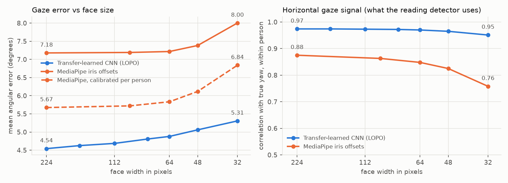

# Gaze detection — `feature/gaze-detection`

Work branch for building, training and evaluating the **reading-gaze** ("eye
detection") signal of OpenMeet's answer-integrity check (cheating detection).
The other signal, AI-echo answer analysis, is developed separately on
`feature/echo-detection`. The two are combined only after both are merged.

> Status: the code for Phases 0–2 is in place: the environment, the GazeBase
> loader, webcam simulation, reading features, rule-based and learned
> detectors, and the MediaPipe video pipeline, covered by 41 tests. The
> **visual model is trained**: a transfer-learned gaze CNN with 4.54° error
> on unseen people (MPIIFaceGaze, leave-one-person-out), against 7.18° for the
> current MediaPipe approach. See
> [Learned gaze model](#learned-gaze-model-transfer-learning). The reading
> detector has not been run on GazeBase yet. Nothing from this branch is wired
> into the app. The `IntegrityAnalyzer` and `GazeProvider` exist only in the
> design diagrams (process 11.0 "Assess answer integrity" in the DFDs, steps
> 11.5–11.6). See [Getting started](#getting-started).

## What we're detecting

Eyes move in a recognisable way when someone reads text off a screen. They
step left to right along a line, then snap back to the start of the next
line. Plotted over time, horizontal gaze looks like a sawtooth.

While the candidate answers, OpenMeet watches their video tile in the meeting
window and asks: are the eyes doing that reading pattern, or holding on one
off-camera spot for long stretches?

Looking away on its own is **not** the signal. People naturally look up or
away when they think. We look specifically for *reading*.

## How the signal works (planned)

1. **Find the face.** Capture the candidate's video tile from the meeting
   window at about 10 fps. This is the same picture the interviewer already
   sees, and nothing is installed on the candidate's machine. Crop to the
   face.
2. **Landmarks.** Run MediaPipe Face Landmarker in the local AI sidecar. Its
   478 landmarks include the irises, and its blendshape scores include
   eye-look directions, which give a cheap second gaze estimate.
3. **Gaze direction.** Compute the iris position relative to the eye corners
   and lids, giving horizontal and vertical gaze ratios. Read head pose from
   MediaPipe's facial transformation matrix, so head turns aren't mistaken
   for eye movement. Drop blink frames.
4. **Reading pattern.** Build a gaze time series over each answer and
   extract features:
   - **return sweeps**: large, fast right-to-left jumps after slower
     left-to-right drift
   - **regularity**: whether the sweeps repeat at a similar rhythm, since
     lines of text are similar lengths
   - **off-camera fixation**: share of the answer spent looking at one
     off-screen spot, compared with the same person while listening
5. **Score.** Turn the features into a per-answer reading score.

Start rule-based: a sawtooth detector plus thresholds, which is easy to
explain. Then try a learned model, first logistic regression on windowed
features, and a small 1D-CNN or GRU only if there is enough data.

## Known hard parts

Be ready to explain these in the report and the viva:

- **Frame rate.** At 10 fps we can't see individual saccades, which last only
  tens of milliseconds. Return sweeps happen once per line, every few
  seconds, which 10 fps captures easily (it resolves motion up to 5 Hz).
  The detector must rely on line-level patterns, not saccades.
- **Resolution and compression.** In gallery view the face may be only
  100–200 px wide, which leaves each eye just a few pixels. Measure how
  accuracy drops as the tile shrinks.
- **Glasses, reflections, lighting, dark irises and camera position** (a
  laptop camera below the screen versus an external webcam).
- **Text right next to the camera.** A cheater can place the answer just
  under the webcam, which makes the sweeps small. Record this condition and
  report the result honestly.
- **Finding the right tile.** Meeting apps lay out video differently. Version
  1 uses the screen-region selection OpenMeet already has: the interviewer
  marks the candidate's tile.
- **Capture rate.** The app's screen sampler runs at 1 fps by default with
  change detection. Gaze needs a separate 10 fps sampler for the tile only,
  and only while the candidate is answering, to keep CPU use low.

## Datasets

Public data lets us build the gaze tracker and the reading detector before
our own recordings exist. None of it shows exactly our case (a candidate in a
video call reading an AI answer), so our own collection is still required.

| Dataset | What it is | Access | How we use it |
|---|---|---|---|
| [OEP (Online Exam Proctoring)](https://cvlab.cse.msu.edu/oep-dataset.html) | 24 people acting out several kinds of cheating in online exams, recorded by webcam, wearable camera and microphone (Atoum et al., *Automated Online Exam Proctoring*) | Download from the MSU page; cite the paper | Closest public match to our task: an external test set on real webcam footage of cheating |
| [EVE](https://ait.ethz.ch/eve) | Webcam video synchronised with screen recordings and ground-truth gaze, covering natural eye movements ([code](https://github.com/swook/EVE)) | Request form; CC BY-NC-SA 4.0 with extra terms | Check our MediaPipe gaze ratios against true gaze, then degrade the video (smaller, compressed, 10 fps) to see where the signal breaks |
| [MPIIFaceGaze](https://doi.org/10.18419/darus-3240) | 37,667 face images from laptop webcams in everyday conditions, with gaze labels ([MPI page](https://www.mpi-inf.mpg.de/departments/computer-vision-and-machine-learning/research/gaze-based-human-computer-interaction/its-written-all-over-your-face-full-face-appearance-based-gaze-estimation)) | Open download; CC BY-NC-SA 4.0 | Validate gaze direction across lighting, glasses and real laptop cameras |
| [GazeBase](https://figshare.com/articles/dataset/GazeBase_Data_Repository/12912257) | 322 people recorded by a 1000 Hz eye tracker on seven tasks, including **reading**, fixation and video viewing | Open download on figshare; also loadable with pymovements | Real reading scanpaths. Downsample to 10 Hz and add webcam-level noise to create realistic "reading" vs. "not reading" traces for the detector |
| [GECO (Ghent Eye-tracking Corpus)](https://expsy.ugent.be/downloads/geco/) | English monolinguals and Dutch–English bilinguals reading a whole novel, word-level eye-movement measures | Open download (Excel files) | Reading statistics (fixation durations, line timing) and a native vs. non-native reader comparison for the bias check |
| [MIT Interview Dataset](https://roc-hci.com/past-projects/automated-prediction-of-job-interview-performances/) | 138 recorded mock job interviews (69 students), with video, audio and transcripts | Request form; needs an academic email | Natural gaze while answering interview questions, including looking away to think (hard negatives) |

Tools: [MediaPipe Face Landmarker](https://developers.google.com/edge/mediapipe/solutions/vision/face_landmarker)
([Python guide](https://developers.google.com/edge/mediapipe/solutions/vision/face_landmarker/python)),
OpenCV (head pose, video re-encoding), and
[pymovements](https://github.com/aeye-lab/pymovements) (loads eye-tracking
datasets such as GazeBase, and detects fixations and saccades).

## Our own data

Mock interviews with volunteers, held over a real call so the video goes
through real compression. Record the candidate's tile **from the
interviewer's screen**, exactly what OpenMeet would see.

| Condition | Label |
|---|---|
| Answers naturally, looking at the screen or camera | not reading |
| Thinks with natural gaze aversion (up, away) | not reading (hard negative) |
| Glances at their own notes now and then | separate label (whether this counts depends on the interview's rules) |
| Reads an AI answer: near the camera, side of the screen, second monitor, phone | reading |

Vary glasses or no glasses, lighting, webcams, and tile size (gallery view
versus speaker view).

**One collection for both branches.** Each session records the candidate's
audio as well, so the same recordings and labels feed the echo branch too.
Plan and run data collection together, once.

**Data rules**

- Face video is sensitive personal data. Get written consent from every
  participant. Anyone can withdraw and have their data deleted.
- **Never commit video, frames, landmark dumps or anything else tied to a
  participant.** Keep them in the team's private storage. Commit only code
  and aggregate results. Add `training/*/data/` to `.gitignore` before the
  first recording lands in this folder.
- We never identify anyone: no face recognition, no stored face templates.
  Use anonymous session ids.

## How we'll measure it

- Split train and test **by person**, so no participant appears in both.
- Report ROC-AUC, precision and recall, and the **false-positive rate at the
  chosen threshold**.
- Robustness curves: accuracy against face size in pixels and against frame
  rate (5, 10, 15 fps).
- Per-subgroup results: glasses, lighting, camera position, native vs.
  non-native readers.
- Per-frame processing time on a laptop CPU. It must keep up with 10 fps.

## Implementation plan

Each phase ends with something we can show. Dates go in once we know the
project deadlines.

### Phase 0: Set up

- Python environment for this folder (mediapipe, which brings OpenCV, plus
  numpy, scipy, pandas, scikit-learn and matplotlib).
- Add `training/*/data/` to `.gitignore`.
- Write down the evaluation protocol (person-level split, metrics, target
  false-positive rate) **before** looking at any results.

*Done when:* the skeleton scripts run end to end on a short test video.

### Phase 1: Gaze from video (MediaPipe; EVE, MPIIFaceGaze)

- Wrap Face Landmarker in video mode. Output per-frame horizontal and
  vertical gaze ratios for each eye, head pose, and a blink flag.
- Compare our ratios with ground-truth gaze on EVE and MPIIFaceGaze. We need
  *relative* movement (left vs. right), not calibrated screen coordinates,
  so measure correlation, not absolute error.
- Degradation study: shrink faces to 200, 150, 100 and 75 px wide, re-encode
  at low bitrate with ffmpeg, and resample to 5, 10 and 15 fps. Find the
  smallest tile where horizontal sweeps are still visible.

*Done when:* a short gaze-quality report exists, stating the minimum usable
tile size.

### Phase 2: Reading detector on eye-movement data (GazeBase, GECO)

- Take GazeBase reading and non-reading tasks, downsample from 1000 Hz to
  10 Hz, and add noise at the level measured in Phase 1. This gives
  webcam-quality "reading" and "not reading" traces.
- Build the rule-based sawtooth detector: find return sweeps, count them per
  minute, and measure the regularity of the gaps between them.
- Train the learned baseline: windowed features into logistic regression.
- Use GECO to sanity-check line timing and compare native and non-native
  readers.

*Done when:* we have a ROC-AUC on the simulated traces and a chosen detector
configuration.

### Phase 3: Collect our own data (shared with the echo branch)

- Write the protocol, consent form and condition schedule. Randomise the
  condition order per participant.
- Pilot with 2–3 teammates, then fix whatever was awkward.
- Record over a real call from the interviewer's side, and keep a label
  sheet per answer.
- Keep OEP aside as an external test set.

*Done when:* the dataset is collected and documented in a data card (in git,
no raw data).

### Phase 4: Evaluation

- Run the full pipeline (video → landmarks → gaze series → reading score) on
  our recordings with the person-level split.
- Choose the threshold for a target false-positive rate (e.g. ≤ 5%).
- Produce ROC curves, the false-positive rate at the threshold, robustness
  curves, per-subgroup results, the OEP external-test result, per-frame CPU
  time, and a look at every false positive.

*Done when:* results and plots in `results/` are ready for the report.

### Phase 5: Integrate into OpenMeet

- `local-ai`: a loopback-only `POST /v1/gaze` endpoint. It takes a face crop
  and returns landmarks, gaze ratios and head pose, and never logs or stores
  frames. Add `mediapipe` to `requirements.txt`, with tests on synthetic
  images.
- `openmeet-core`: a `GazeProvider` trait and gaze types, alongside the
  existing provider traits.
- `openmeet-providers`: a `LocalAiGaze` adapter for the endpoint.
- `openmeet-platform` / `openmeet-engine`: a 10 fps sampler for the selected
  candidate tile, running only while the candidate is answering.
- `openmeet-engine`: the `IntegrityAnalyzer` builds the gaze series and
  computes the reading score in Rust (rules plus logistic weights from a
  small JSON file). The sidecar stays stateless.
- Settings: gaze on/off, **off by default**. The privacy page shows it when
  it's on.

*Done when:* an engine test with a mock gaze provider covers the flow end to
end, and a live test runs it with the real sidecar.

### Phase 6: Fuse with the echo signal (joint, after both branches merge)

Combine the reading and echo scores into one flag, re-tune the threshold on
the shared recordings, and report how much each signal adds.

## Getting started

Python 3.11–3.13. From this folder (`training/gaze-detection`):

```bash
py -3.13 -m venv .venv              # macOS/Linux: python3 -m venv .venv
.venv\Scripts\activate              # macOS/Linux: source .venv/bin/activate
pip install -r requirements-dev.txt
python download_model.py            # MediaPipe face model, 3.8 MB, into models/
python -m pytest                    # 41 tests, about 20 s
```

`.venv/`, `data/` and `models/` are git-ignored. This folder sits inside
OneDrive, which will try to sync the virtual environment and the 6.7 GB
dataset. Exclude them from OneDrive, or keep the dataset elsewhere and pass
`--data`.

### Running the pipeline

```bash
# Plumbing check on synthetic traces (no download; the numbers mean nothing)
python prepare.py --synthetic 8
python train.py --features data/features/synthetic_10fps.csv --out data/smoke

# The real thing
python download_gazebase.py                # 6.7 GB, resumes if interrupted
python prepare.py --max-participants 10    # quick first look
python prepare.py                          # all of GazeBase → data/features/gazebase_10fps.csv
python train.py                            # → results/cv_report.json, results/model.json
python prepare.py --noise 3 --out data/features/gazebase_noisy.csv   # robustness runs

# Held-out data (our own recordings, OEP), at the saved threshold
python evaluate.py --model results/model.json --features data/features/<held-out>.csv

# Try it on a video, e.g. a clip of yourself reading vs. talking
python extract_video.py clip.mp4                       # rule-based, no training needed
python extract_video.py meeting.mp4 --roi 640 0 640 360 --model results/model.json
```

### Code layout

```
training/gaze-detection/
  readgaze/                 the library
    trace.py                GazeTrace: the common format; resampling, gap filling, windows
    simulate.py             lab eye-tracker trace → webcam-quality trace
    synthetic.py            synthetic traces for tests and smoke runs only
    datasets/gazebase.py    GazeBase loader (reads the zip directly, nested zips included)
    features.py             the six reading features, plus sweep times as evidence
    detector.py             rule-based detector; window scores → one answer score
    model.py                logistic regression; JSON export for the Rust engine
    evaluation.py           threshold at a target false-positive rate; metrics
    pipeline.py             recordings → feature table (one row per window)
    training.py             person-level cross-validation; final fit
    landmarks.py            MediaPipe Face Landmarker → iris offsets, blinks, head pose
    video.py                video file → gaze trace
  download_gazebase.py      dataset download (into data/, git-ignored)
  download_model.py         face model download (into models/, git-ignored)
  prepare.py                build the feature table
  train.py                  cross-validate and export model.json
  evaluate.py               score held-out data at the saved threshold
  extract_video.py          run the detector on a video
  notebooks/
    gaze_transfer_learning.ipynb   the visual model: transfer learning on Kaggle (self-contained)
  plot_gaze_model.py        redraw results/gaze_model_robustness.png from the results JSON
  tests/                    pytest suite
  results/                  aggregate metrics, model.json, gaze-model results (committed)
```

## Evaluation protocol

Fixed before any results are seen:

- **Unit of decision: one answer.** Gaze is cut into 10 s windows every 5 s,
  and the answer's score is the mean of its top half of window scores. On
  GazeBase, one recording stands in for one answer.
- **Positives and negatives.** GazeBase's reading task (TEX) is positive.
  Every other task is negative, and flag rates are reported per task. The
  horizontal-saccade task (HSS) is the hardest negative.
- **Split by person.** 5-fold `StratifiedGroupKFold`, grouped by participant
  ID. GazeBase participants return across rounds, so grouping by round would
  leak.
- **Operating point.** The threshold allows at most **5% false positives** on
  honest recordings. Recall at that threshold is the headline number;
  ROC-AUC comes second.
- **Both detectors, every time.** The learned model is only worth keeping if
  it beats the rule-based one.
- **Robustness.** Repeat with doubled noise (`--noise 3`) and halved eye
  movements (`--amplitude 0.5`, text near the camera).
- **Known gap.** GazeBase is silent reading of a poem with the head on a chin
  rest. Our case is reading aloud from a chat window with the head free. The
  simulation narrows that gap but doesn't close it, so only our own
  recordings (Phase 3) give the real numbers.

## Learned gaze model (transfer learning)

The visual model. A CNN takes a normalised face crop and returns gaze pitch and
yaw. It is meant to replace the MediaPipe iris offsets as the input of the
reading detector, which only needs a clean horizontal gaze trace.

- Notebook: [notebooks/gaze_transfer_learning.ipynb](notebooks/gaze_transfer_learning.ipynb)
  (Kaggle, *GPU T4 x2*, *Internet on*; about 4.5 GPU hours end to end, which
  is 2–2.5 hours of wall time on the two T4s).
- Numbers: [results/gaze_model_results.json](results/gaze_model_results.json).
  Chart: [results/gaze_model_robustness.png](results/gaze_model_robustness.png),
  redrawn with `python plot_gaze_model.py`.

**Why a gaze estimator and not a "reading from video" classifier.** No
labelled video of people reading answers exists yet. GazeBase is eye-tracker
coordinates, and our own recordings are Phase 3. A video classifier can't be
trained or tested honestly on what we have. A gaze estimator can:
MPIIFaceGaze has 37,667 laptop-webcam faces of 15 people with gaze labels,
and networks already trained for gaze exist to start from.

### Setup

- **Data.** MPIIFaceGaze, undistorted and normalised (Zhang et al. 2018) to
  224x224 crops from a virtual camera 600 mm away (focal 960). That is the
  framing ETH-XGaze models use, which the zero-shot check confirms: the
  ETH-XGaze ResNet-18 gets 6.99° on our crops without any fine-tuning, and
  18–25° if a sign convention is flipped.
- **Transfer learning.** Three starting points, all fine-tuned end to end:
  ResNet-18 from ImageNet (timm), and ResNet-18 and ResNet-50 already trained
  for gaze on ETH-XGaze (110 other people, so nothing leaks into the test
  people). An ImageNet ResNet-50 was dropped to save GPU time once the
  ETH-XGaze ResNet-50 turned out no better than the ResNet-18.
- **Training.** L1 loss on pitch and yaw, AdamW, cosine schedule, mixed
  precision, weight EMA. Augmentation: mirror (yaw flipped), shift, scale,
  colour, and for the final model random downscaling to 24–224 px plus JPEG
  q20–70 on small faces. Mirror test-time augmentation.
- **Protocol.** Split by person only. Development: 3 folds of 5 held-out
  people. Final number: leave-one-person-out (LOPO, 15 folds), the standard
  MPIIFaceGaze protocol. Metric: mean over people of each person's mean
  angular error, in degrees.
- **Robustness.** Test faces shrunk to 160–32 px wide (the face fills the
  crop, so this is about the face width in a meeting tile), and JPEG q30 on
  top, like a compressed video call.

### Results

**Final model (LOPO): 4.54° mean angular error** (SD 1.55° over people; best
p00 1.94°, worst p10 6.98°). ETH-XGaze ResNet-18, low-res + JPEG
augmentation.

| Starting point (dev, 3-fold) | Full size | 64 px | 32 px | 64 px + JPEG |
|---|---|---|---|---|
| MediaPipe iris offsets + linear map (current pipeline) | 7.18 | 7.22 | 8.00 | – |
| ETH-XGaze ResNet-18, no fine-tuning | 6.99 | – | – | – |
| ImageNet ResNet-18 | 5.49 | – | – | – |
| ETH-XGaze ResNet-50 | 4.44 | – | – | – |
| ETH-XGaze ResNet-18 | 4.30 | – | – | – |
| ETH-XGaze ResNet-18, 15 epochs + EMA | **4.29** | 4.98 | 5.88 | 7.09 |
| … + low-res and JPEG augmentation (chosen) | 4.35 | **4.72** | **5.19** | **5.64** |
| Final model, LOPO | 4.54 | 4.87 | 5.31 | 5.76 |

MediaPipe is measured on 500 faces per person, with the linear map fitted on
the other 14 people. Fitted per person instead, which needs a calibration
step OpenMeet can't run on a remote candidate, it reaches 5.67° at full size.
The zero-shot row is on 3,000 random faces.



What this shows:

- **The learned model beats the current pipeline by 2.6° and degrades more
  slowly.** More important for reading detection, its within-person
  correlation with true horizontal gaze is 0.97 at full size and still 0.95
  at 32 px. MediaPipe's is 0.88, falling to 0.76 at 32 px.
- **Where the pretraining comes from matters more than model size.**
  Starting from a gaze model instead of ImageNet cuts the error by 1.2°
  (5.49 → 4.30). ResNet-50 is no better than ResNet-18 (4.44), and averaging
  them doesn't help (4.30). We keep the ResNet-18, which is also the cheap
  one.
- **Augmenting for small, compressed tiles is nearly free.** It costs 0.06°
  on full-size faces and saves 0.7° at 32 px and 1.45° on a compressed 64 px
  face.
- **Run-to-run noise is about 0.2°.** The same configuration scored 4.35°
  in development and 4.54° in LOPO, and single people move by up to 1.5°
  between runs. Averaging the held-out predictions of 2–5 separately trained
  runs gives 4.30–4.42°, so ensembling would buy roughly 0.2° for 2–5x the
  compute.
- **Speed.** Exported to ONNX (44.7 MB, preprocessing inside the graph,
  matches PyTorch to 2e-7 rad), one face takes 33 ms on one CPU thread and
  17 ms on two (Kaggle Xeon). That is well inside the 100 ms a 10 fps
  sampler allows.

For context, published within-dataset results on MPIIFaceGaze are 4.8° for
the original full-face network (Zhang et al. 2017) and 3.92° for L2CS-Net
(Abdelrahman et al. 2022). Preprocessing and sample selection differ between
papers, so treat these as a rough guide, not a ranking.

**Limits.** Fifteen people, lab-style laptop sessions, normalised still
images. The degradations are simulated: no real call compression, motion
blur or frame drops yet. Face crops in the app also need the same
normalisation, which takes head pose and camera intrinsics. MediaPipe gives
an estimate of both, but that step isn't built or measured yet. Our own
recordings (Phase 3) and EVE give the real test.

**Getting the model.** Kaggle deletes session files when the session ends,
so the ONNX file isn't in the repo. To rebuild it, run the notebook's
"final" cells (`final_all` and the export cell; about 12 GPU minutes). It is
trained on MPIIFaceGaze and starts from ETH-XGaze weights, both
non-commercial research licences (CC BY-NC-SA 4.0). Keep it out of public
releases and cite both datasets.

## Reading detector

The question: from 10 seconds of gaze at webcam quality, is this person
reading? Two Kaggle runs on 2026-11-12/13 answer it on public data. Code is
in `experiments/` (`kaggle_run.sh` for GazeBase, `kaggle_ritw.sh` for
Reading in the Wild); results are in `results/`.

### Datasets and why

| Dataset | Used for | Why |
|---|---|---|
| GazeBase | train + locked test | 322 people, 211 h, reading (a poem) vs six other tasks (fixation, saccades, two videos, a game, random dots). Big enough to split by person and still have 64 test people. Recorded at 1000 Hz with a chin rest, so we degrade it to webcam quality: 10 fps, noise, drift, blinks, dropped frames (`simulate.degrade`). |
| GazeBaseVR | outside test only | 407 people in a VR headset, 5 tasks. Different hardware, never trained on. |
| DesktopActivity | outside test only | 8 people at a real desktop with the head free: READ vs BROWSE, PLAY, SEARCH, WATCH, WRITE. The closest thing to everyday computer use. |
| Reading in the Wild (Meta) | train + locked test, separately | 81 people (Seattle subset), 47.5 h, eye-tracking glasses in daily life, reading and non-reading in the same places. The best real-world benchmark and the only one with a published gaze-only number. |

### Protocol

Fixed before any test score was read.

- **GazeBase:** people split once (seed 2026): 258 development, 64 test.
  Every choice (features, model, thresholds) comes from 5-fold person-level
  cross-validation on development people. The chosen model is refitted on
  all development people and the test people are scored once.
- **Reading in the Wild:** the authors' split, which is by date and so by
  person: 64 development people (train + val), 17 test people. Same
  procedure.
- Unit: a 10 s window every 5 s at 10 fps (RitW also 5 s windows, to compare
  with the paper). A recording score is the mean of its top half of window
  scores.
- Headline metric: **balanced accuracy**, the mean of the reading and the
  not-reading hit rates. Only 14% of GazeBase windows are reading, so a
  detector that never flags gets 86% plain accuracy. Plain accuracy is given
  where we compare with the paper.
- Thresholds come from development nominal scores and are not moved for the
  harder conditions. Conditions: nominal (noise 1.5°, drift 1°), hard
  (noise 3°, drift 2°), small (eye movements x0.5, i.e. smaller text or a
  farther screen), small_hard (both), slow (a reader at 2/3 speed).
- Candidates: gradient boosting on 58 hand-made features, a 1-D CNN on the
  raw window (3 seeds, trained on clean windows with random webcam
  degradation), and the average of the two.

### Model choice (development people only)

Mean window balanced accuracy over the four GazeBase conditions, 5-fold CV:
boosting 89.2%, **network 94.8%**, average 93.9%. The network was chosen.
It holds up much better under noise because it divides each window by its
own spread (which is also why hard and small give the same network score).

On Reading in the Wild the same procedure picked the **average** of
boosting and network (development mean 82.0%, vs 79.9% boosting and 80.2%
network).

### Results on test people (GazeBase, network, scored once)

| Condition | Window bal. acc. | Window accuracy | Window AUC | Recording bal. acc. |
|---|---|---|---|---|
| nominal | **98.8%** | 99.0% | 0.999 | 99.9% |
| hard | 97.5% | 97.4% | 0.997 | 99.5% |
| small | 97.5% | 97.4% | 0.997 | 99.5% |
| small_hard | 85.5% | 90.2% | 0.949 | 73.4% |
| slow reader | 96.5% | 97.7% | 0.994 | 99.0% |

Test numbers match development CV within 0.4 points in every condition, so
the split did not flatter the model. For small_hard the recording threshold
is too strict (recall 47%, specificity 99.8%), but the ranking is still good
(recording AUC 0.995): the threshold, not the score, is what breaks.

For reference, the boosted model on the same test people: 97.9 / 92.2 /
92.4 / 73.5 / 94.9%.

### Outside data (trained on GazeBase only, GazeBase thresholds)

| Dataset | Network | Boosting | Average |
|---|---|---|---|
| GazeBaseVR, window bal. acc. (AUC) | 96.6% (0.986) | 95.3% | 96.7% |
| GazeBaseVR, recording bal. acc. | 99.3% | | |
| DesktopActivity, window bal. acc. (AUC) | 74.0% (0.825) | 83.9% | 81.1% |
| DesktopActivity, recording AUC | 0.997 | | |

On DesktopActivity the network still ranks every READ recording above the
others (recording AUC 0.997), but at the GazeBase threshold it flags only 2
of 8 READ recordings and none of the 40 others; at the GazeBase
5%-false-positive threshold it flags all 8 but also 15 of the 40 others.
Per window, boosting transfers better than the network here. Real desktop
reading needs its own threshold, which our own recordings will set.

### Reading in the Wild (trained and tested on RitW people)

"Eye tracker" is the glasses' gaze at 10 fps with nothing added; "webcam"
adds our webcam noise, drift and blinks. Test people, chosen model (average):

| Window | Input | Window accuracy | Window bal. acc. | Window AUC | Recording bal. acc. |
|---|---|---|---|---|---|
| 10 s | eye tracker | 82.3% | **83.0%** | 0.908 | 92.9% |
| 10 s | webcam | 78.6% | 79.1% | 0.886 | 90.4% |
| 5 s | eye tracker | 78.0% | 78.7% | 0.874 | 92.5% |
| 5 s | webcam | 75.6% | 75.1% | 0.847 | 86.2% |

Development CV gave 83.6% / 80.4% (10 s) and 79.4% / 76.5% (5 s) window
balanced accuracy, so again test agrees with development.

**Comparison with the paper.** The RitW paper's gaze-only model reaches
82.3% accuracy on 2 s windows and 85.8% on 5 s windows at 60 Hz, and 80.4%
on 2 s at 10 Hz. At 5 s we are 7.8 points below their 60 Hz number (78.0% vs
85.8%); we need 10 s windows to reach their 2 s accuracy (82.3%). The gap is
expected: our input is 10 fps, the rate a webcam pipeline gives, and our
models were built for GazeBase-style lab data, not tuned for RitW. It is
also much harder than GazeBase. The per-task flag rates (10 s, test
people) show where: the non-reading tasks 8-11 are flagged 11-20% of the
time, while some reading tasks are flagged far less than others (tasks 2
and 17 about 44%, tasks 12 and 13 about 60%, most others 80-99%).

### Limits

- GazeBase reading is silent reading of a poem with a chin rest, and the
  negatives are lab tasks, not a person talking in an interview. The 98.8%
  is a ceiling for clean, simulated webcam gaze, not an expected field
  number.
- Webcam quality is simulated, not measured on video. Real webcam gaze
  comes from the visual model above (4.54° error), which is worse than the
  simulated nominal noise of 1.5°.
- Small text plus double noise (small_hard) is near the floor: 85.5% per
  window, and the recording threshold needs to move.
- Reading in the Wild, the only real-world set, gives about 79-83% per
  window at 10 s. Per recording (a whole answer) it is 90-93%.
- Not yet run: the GazeBase-only network scored zero-shot on RitW test
  people (`ritw_run.py --gazebase-weights`). Only our own recordings
  (Phase 3) give the number that matters for OpenMeet.

## Training in the cloud

Yes, it can be trained in the cloud, but it doesn't need to be. Training is
logistic regression on a few thousand rows of six numbers, which takes
seconds on any laptop, and there is no GPU work at all. The slow step is
`prepare.py` working through the 6.7 GB GazeBase download, which is CPU and
disk bound. A GPU only matters later, if we try a 1D-CNN or GRU, or run
MediaPipe over many hours of video.

Free options: Google Colab or Kaggle Notebooks, or a university lab or HPC
machine. In a Colab notebook:

```bash
!git clone -b feature/gaze-detection https://github.com/AekamSidhu/Major-Project.git
%cd Major-Project/training/gaze-detection
!pip install -q -r requirements-dev.txt
!python -m pytest -q
!python download_gazebase.py
!python prepare.py
!python train.py
```

Then download `results/cv_report.json` and `results/model.json` and commit
them from your own machine.

**Data rule for the cloud:** public datasets (GazeBase is CC BY 4.0) are
fine. Our own recordings of participants are not, unless the consent form
explicitly allows cloud processing and the university's data policy permits
that service. Otherwise, process them locally: everything here runs on a
laptop.

## Ground rules

- A flag is a **signal for the interviewer, never a verdict**. It always
  comes with evidence (timestamps, the gaze trace), and the human decides.
- Missing a cheater is better than flagging an honest candidate. Choose
  thresholds accordingly.
- In the app, frames are processed in memory and discarded. They never go to
  a cloud provider.

## Checklist

- [x] Phase 0: environment, `.gitignore`, evaluation protocol written
- [ ] Phase 1: gaze-quality report and minimum tile size. Partly done on MPIIFaceGaze stills: the learned gaze model (4.54° LOPO) vs MediaPipe (7.18°), with error vs face size down to 32 px and JPEG. Still to do: real video (EVE), frame rate, and face normalisation from MediaPipe head pose
- [x] Phase 2: reading detector measured on GazeBase test people (98.8% window balanced accuracy at nominal webcam quality, 85.5% in the hardest condition), two outside datasets and Reading in the Wild (83.0% at 10 s); see "Reading detector"
- [ ] Phase 3: own dataset collected (with the echo branch)
- [ ] Phase 4: evaluation, threshold and false-positive rate, robustness and bias checks
- [ ] Phase 5: integrated into the app behind a setting
- [ ] Phase 6: fused with the echo signal
